# Connect and the tab bar, editorial direction · report

Branch: `connect/editorial` · Date: 26 November 2026
Scope: Connect (the tab and a Circle's page) and the tab bar, in two separate commits. Today, Discover and Practice are unchanged; Profile keeps its look.

## Connect

1. **The tab.**
   - A large serif title and the intro.
   - The two ways in as pills: **Create a Circle** (plum) and **Join with a code** (outline).
   - **Your Circles:** each Circle is a line on a fine rule, with its **medallion**, its name in serif, its members, "Challenge" when there is one, and the last message.
     - The medallion is redrawn in the language of Discover's monograms: the Circle's initials in serif on lilac, a fine iris ring set a little apart, and the members as small paper seals resting on the ring, 42° apart so they never overlap.
   - The privacy note.
   - **Following:** instructors and studios as large monograms on a rail, never photographs (C-8).
2. **A Circle's page.**
   - It opens on **lilac with the Circle's initial as a drop cap**, the same device as the studio and instructor pages.
   - On the cream sheet:
     - "Private Circle", the name in serif;
     - the members as **monograms laid side by side like seals**, read in one line by VoiceOver ("5 members, You, Inès, Katya, Giulia, Sam").
   - **The challenge:** a paper card with **a fine thread per member that grows to their real progress**. A member who does not share their activity gets "Activity not shared", never a guess.
   - **The conversation:**
     - soft bubbles (lilac for you, paper for others, the corner nearest the author a little tighter);
     - events of the Circle set between two fine rules;
     - **a shared class shown like a line of the timetable, with its time in serif**.
   - The composer stays at the bottom: a rounded field and a round plum Send button, with a light haptic when a message is sent.
3. **Sheets** (create, join): rounded fields and pill buttons. Joining still needs accounts and says so; the button stays disabled.

## The tab bar

* **Before:** docked under a plum rule, with the C-9 mark.
* **Now:** cream with a hairline above, the same ORÉVA icons and labels. The active tab is plum and heavier, and **a short iris rule slides to it on a spring**, like the Programs and Sessions views of Practice. Tabs give under the finger on the same firm spring as every other control.
* **Unchanged:** labels on every tab, one line up to 130% text size, tabs announced with their selected state, the selection haptic, and no navigation when the active tab is pressed again.
* **With Reduce Motion,** the rule moves at once.

## Motion and Reduce Motion

| Moment | Motion | With Reduce Motion |
| --- | --- | --- |
| Tab bar | The iris rule slides on a spring with no bounce | Moves at once |
| Circle's page | The drop cap settles and moves at a third of the scroll speed; the challenge threads grow to their value (600 ms) | Still letter, threads drawn at their value |
| Connect tab | Blocks rise 70 ms apart, first five only | Shown at once |
| Presses | Firm spring (rows, monograms, pills, Send, tabs) | A slight dim |

## Shared changes

* `DetailLayout` takes a `footer`: a bar laid out under the page (the composer, which grows with the message), next to the sticky `action` used by Practice.
* `dropCap` moved to `src/ui/editorial` (used by Discover and Connect).

## Tests and checks

| Check | Result |
| --- | --- |
| `pnpm check` (18 tasks), `pnpm format:check` | Pass |
| Mobile tests | 179 (were 169), the same three runs in a row. New tests check:<ul><li>Connect: the serif title and the two ways in; a Circle as one button with name and members; followed partners as monograms with no image.</li><li>Circle page: a drop-cap panel with no image and a back button; members read as one line; each thread labelled with name and progress; a shared class with its time; Send with a light haptic; Reduce Motion.</li><li>Tab bar: one sliding mark, hidden from VoiceOver, with and without Reduce Motion.</li></ul>All earlier Connect and tab bar tests are unchanged and pass. |
| Native fingerprint | `e3776e1e…`, unchanged: no new build needed after the merge |
| Web export | Bundles, no console errors |

## Screenshots (web build, standard iPhone unless noted)

| Connect | Scrolled | FR | RU |
| --- | --- | --- | --- |
| 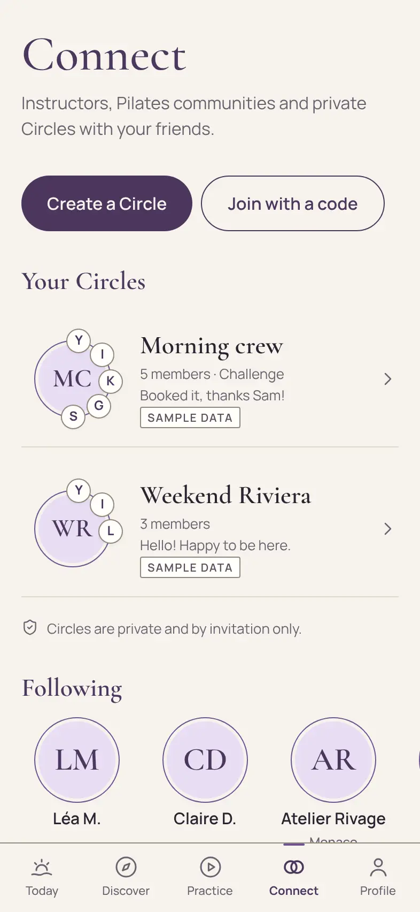 | 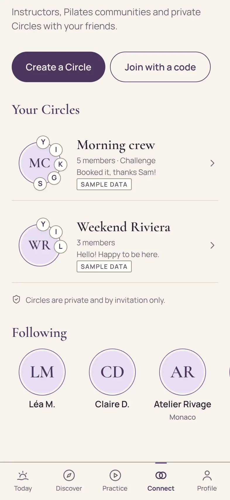 | 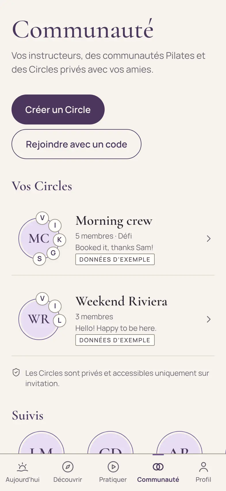 | 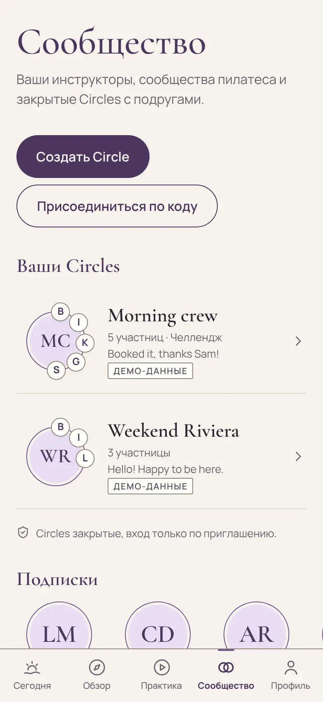 |

| Circle | Challenge and conversation | End | RU |
| --- | --- | --- | --- |
| 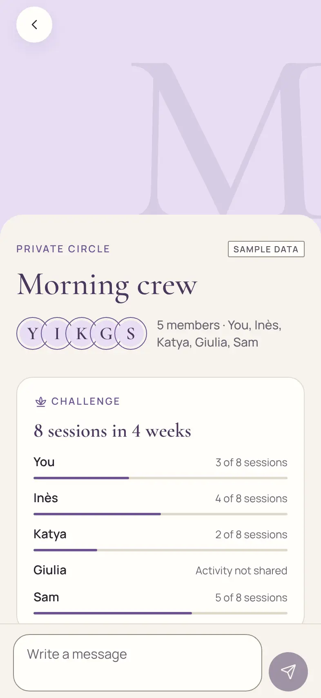 | 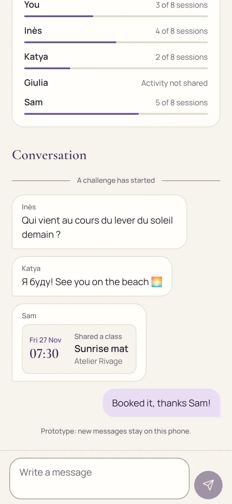 |  | 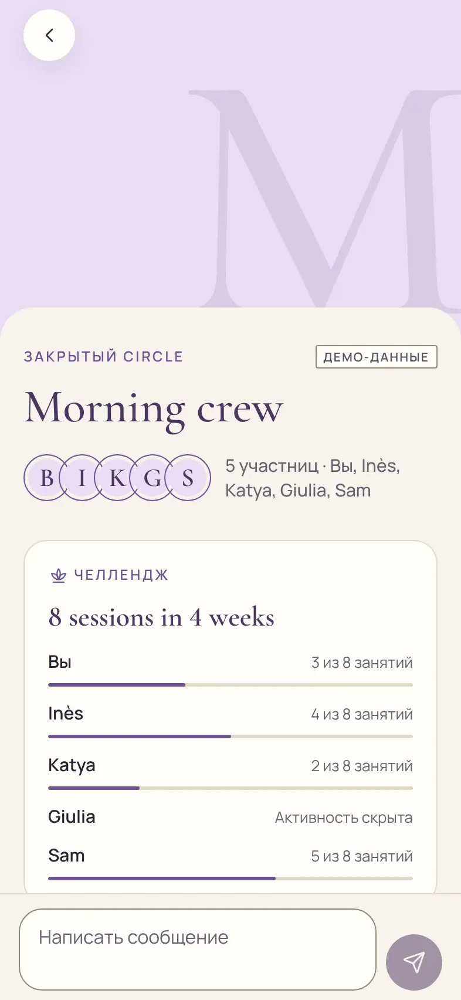 |

| Tab bar on Today | On Practice | iPhone SE Connect | SE Circle | Pro Max Circle |
| --- | --- | --- | --- | --- |
| 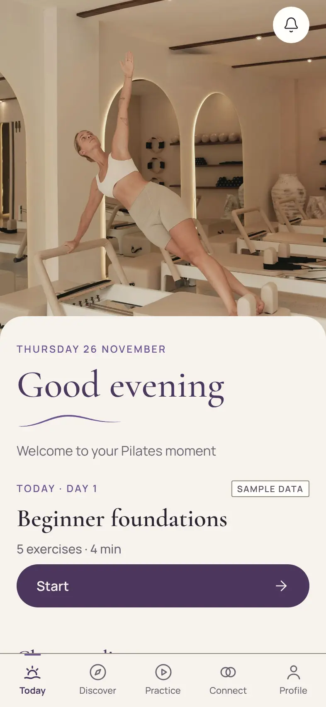 | 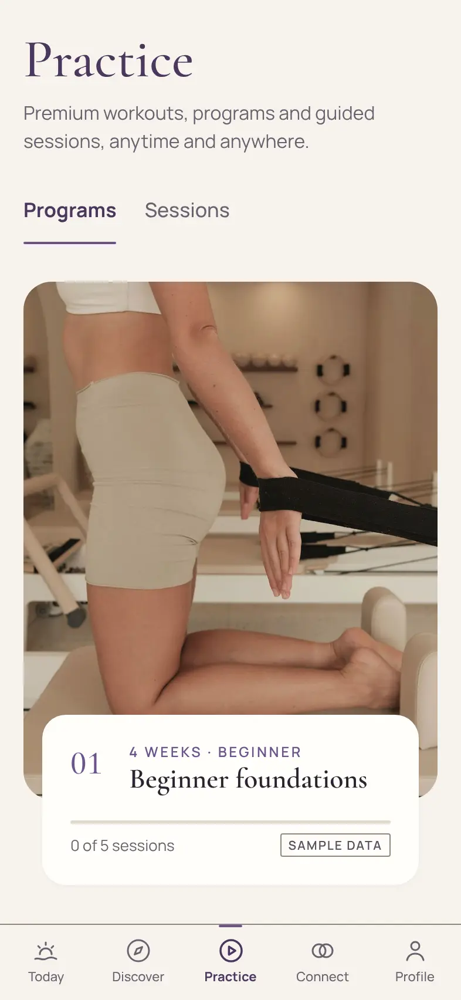 | 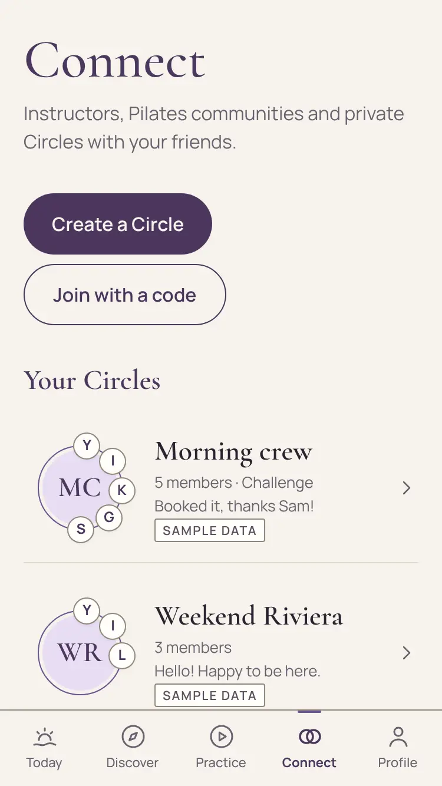 | 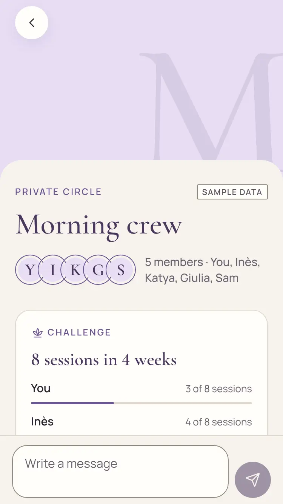 | 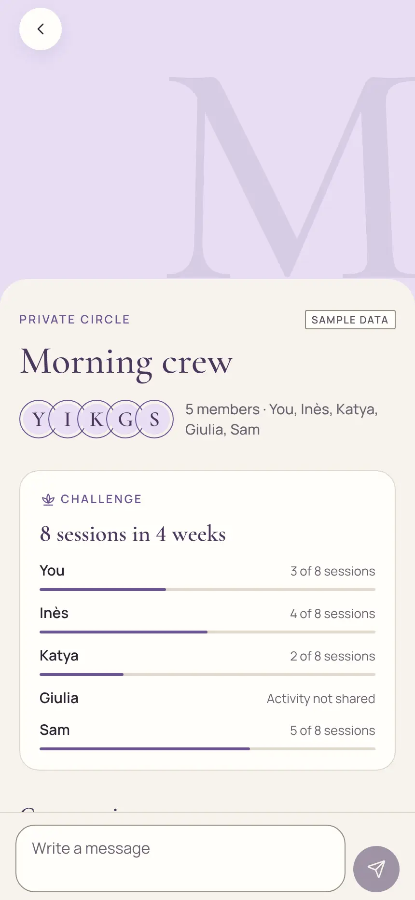 |

## Not verified here

* The feel on the iPhone: the tab rule sliding, the keyboard rising under the composer, the long-press on a message (report, block).
* VoiceOver on the device; Android.
