# Discover, editorial direction · report

Branch: `discover/editorial` · Date: 26 November 2026
Scope: Discover only (map and list, map preview, class, studio, instructor, filter chips). Today and Practice are unchanged except for one shared layout component; Connect, Profile and the tab bar keep their look.

## The design problem

Discover shows partners: studios, instructors and their classes. Decision C-8 says a partner never wears a stock photograph: a picture of a studio that is not theirs would be a lie. Today and Practice rest on photographs, so Discover needed an editorial look without one. The answer is **type and colour**.

## What Discover is now

1. **The map.**
   - **Controls:** the search field is a paper pill floating over the map. Near me is a round paper button, the same as the back button on every page. Filters and List are paper pills.
   - **The card under the map** names the area in small capitals (the city, "Near me" or "Everywhere"), then the number of classes in serif, then the way to the list. It changes with a short rise.
   - **The preview of a place:** the studio's **monogram** (serif initials in its tint, inside a fine iris ring set a little apart, like a seal), its kind, its name in serif, the place or, for a private studio, only the approximate area. Below come **the next class with its time in serif** and "View profile".
2. **The list.** It is an editorial timetable:
   - the area, the count in large serif;
   - each day as a **serif heading on a fine rule**;
   - each class as a line with **the time in serif at the start**, then what, who, where (with the distance near you), kind and level, price and places.
   - The controls sit on a cream bar over the list, so the timetable never shows through them.
3. **The class page.** It opens on the studio's tint with **the day and the time in large serif (76 pt)**, the length beside it and the local-time note under it: **the time is the picture**.
   - Then comes the cream sheet: kind, the title in serif, studio and instructor, the fictional-profile notice.
   - Level, language and places sit on a fact strip, with the price in serif below.
   - "Where" gives the place, or only an approximate area for a private studio.
   - The instructor and the studio appear as monogram rows.
   - **Book** stays disabled with its reason: never a fake booking.
4. **The studio and instructor pages.** They open on a solid panel in the partner's tint with **their initial as a very large serif drop cap**, tone on tone, cut by the panel's edge. It is a magazine device, and it reads as designed rather than generated.
   - **Follow** sits on the panel as a plum pill. It turns to paper with a check, with a light haptic, and is announced with its selected state.
   - On the sheet:
     - kind and city, the name in serif, facts, About, places;
     - instructors as large monograms on a rail;
     - for an instructor: where they teach and their declared qualifications;
     - upcoming classes as timetable lines.
5. **Filters:** pill chips, like Practice.

## Motion and Reduce Motion

| Moment | Motion | With Reduce Motion |
| --- | --- | --- |
| Partner pages | The drop cap settles in (fades in, rises 24 pt, 0.8 s) and moves at a third of the scroll speed; blocks rise 70 ms apart | Letter still, blocks shown at once |
| Card under the map | Rises when a place is selected or closed | Changes at once |
| Presses (classes, rows, monograms, pills, Follow) | Firm spring | A slight dim |

Every animation runs on the UI thread (Reanimated).

## Shared components

* **`TypeHero`** (`src/ui/editorial`): the tinted panel with a drop cap or content, used by the three partner pages.
* **`Monogram`:** serif initials on a tint in an iris ring.
* **`DetailLayout`** now takes `hero: { kind: 'photo' } | { kind: 'type' }` and a `trailing` control (Follow). Practice passes its photographs exactly as before.
* **`FactStrip`:** labels may take two lines and values four, so long values (three languages) wrap instead of being cut.

## Colour pairs

Three new text pairings, added to `contrastPairs` and checked for WCAG AA by the token tests:

* plum on lilac (the class time on a lilac studio);
* stone on lilac and stone on mist (the local-time note).

## A test that failed at random, and why

After the redesign, the city name appears twice on the map screen: in the search field and in the card under the map. Four Discover tests looked for the city text anywhere. I changed them to look inside the search field, but checked it before the city list had loaded. Under load the check ran too early, and the suite failed about one run in three. The tests now wait for the city inside the field. Eight full runs in a row pass.

## Tests and checks

| Check | Result |
| --- | --- |
| `pnpm check`, `pnpm format:check` | Pass |
| Mobile tests | 169 (were 161), stable over 8 full runs. New tests check: drop caps (articles skipped, Cyrillic); no image on a partner's page (C-8); Follow on the hero, with its state; Reduce Motion; spoken back button; the class time read as one sentence with local time and length; class to instructor and studio; "Everywhere" once the city is cleared; preview with the next class and its time, opening the class, Close. All earlier Discover tests are unchanged, except that four city checks are now scoped to the search field. |
| Token tests | 63 (were 60): the three new pairs pass AA |
| Native fingerprint | `e3776e1e…`, unchanged: no new build needed after the merge |
| Web export | Bundles, no console errors |

## Screenshots (web build: the web has no map, so Discover shows the list)

| List | Scrolled | Class | Class, below |
| --- | --- | --- | --- |
| 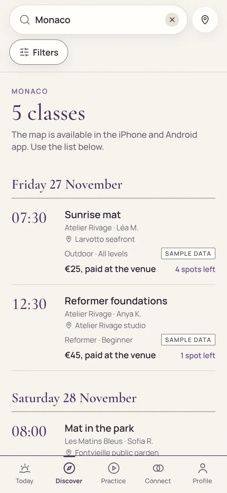 | 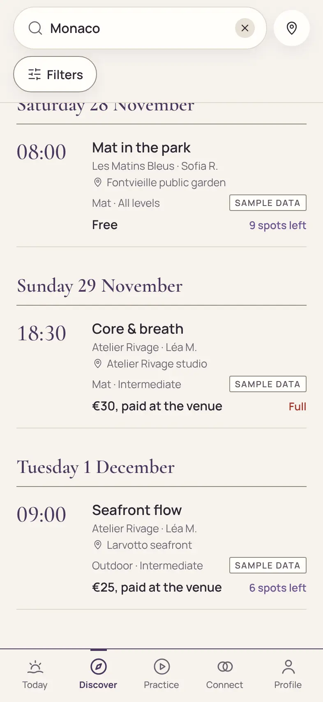 | 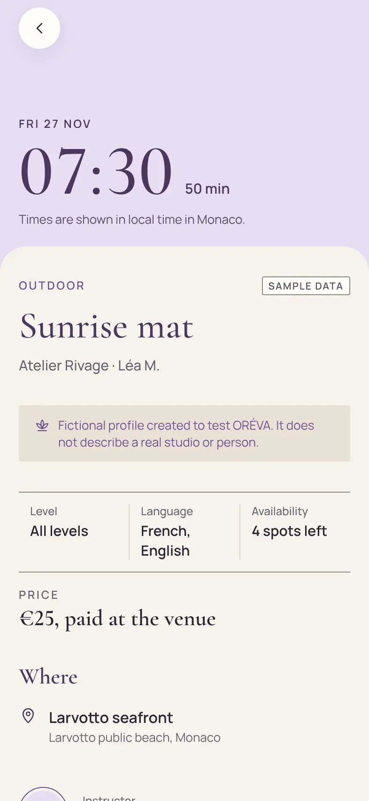 | 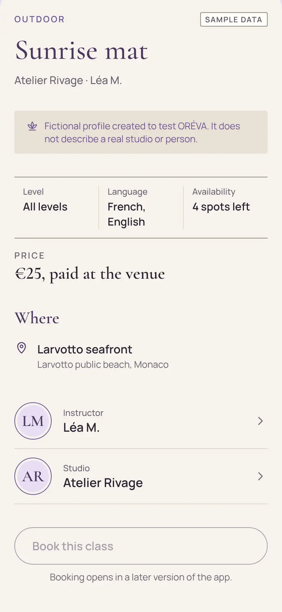 |

| Studio | Studio, below | Instructor | Instructor, below |
| --- | --- | --- | --- |
|  | 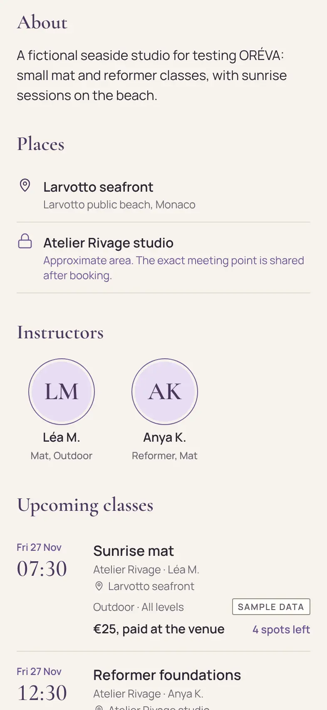 | 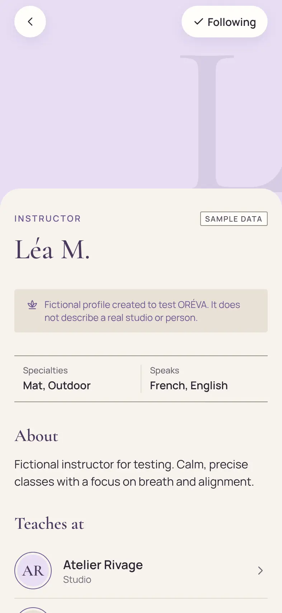 | 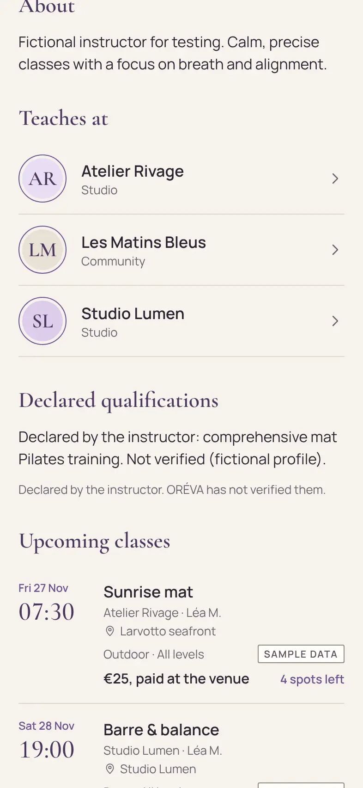 |

| FR class | RU class | RU studio | iPhone SE list | SE class | Pro Max studio |
| --- | --- | --- | --- | --- | --- |
| 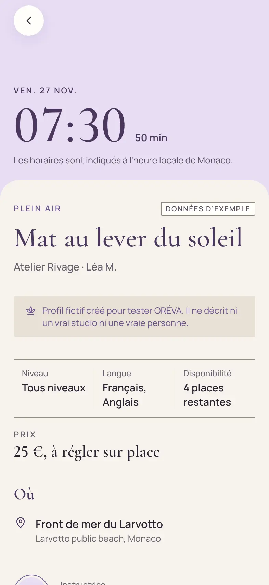 |  | 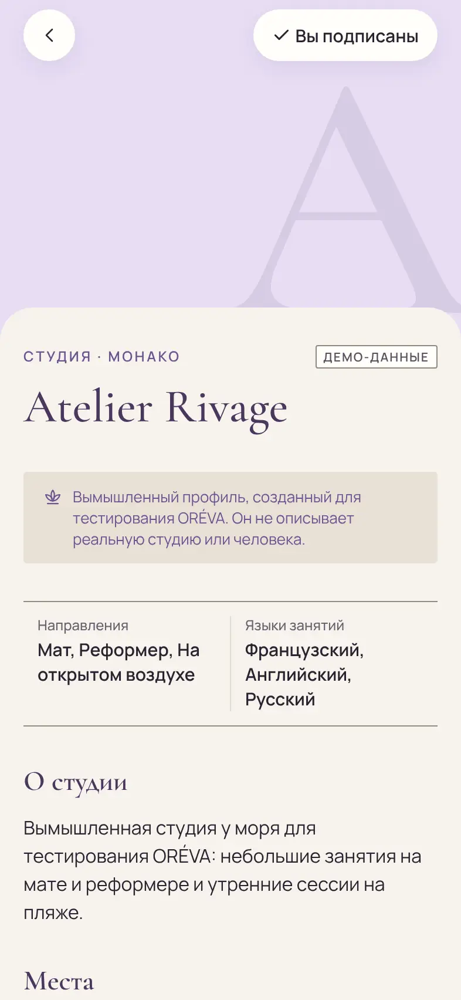 | 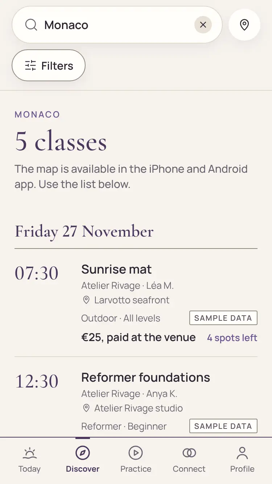 | 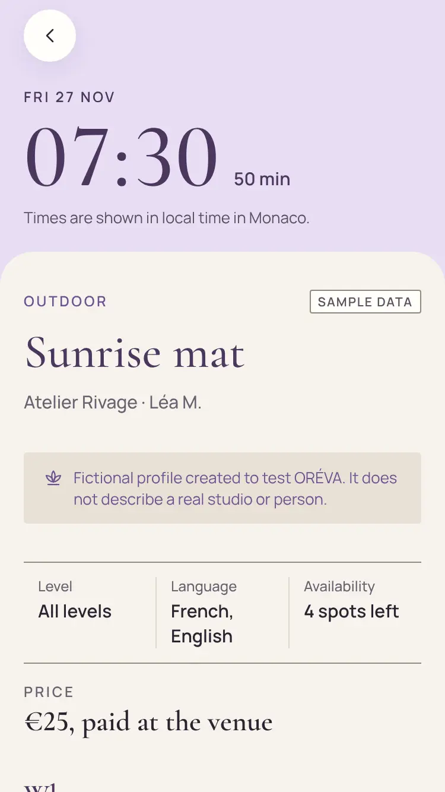 | 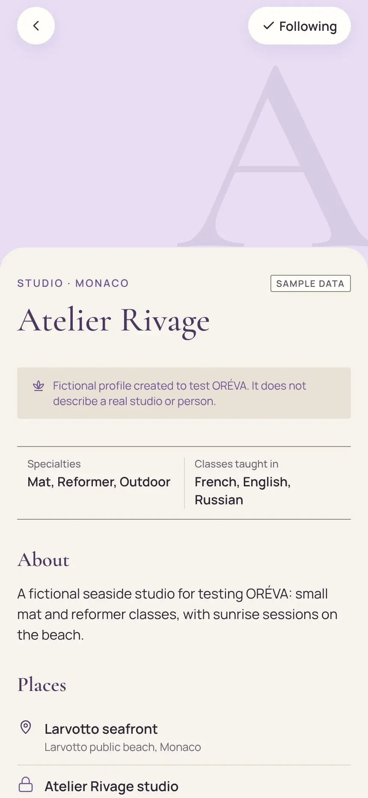 |

## Not verified here

* **The map itself:** the controls over it, the card under it and the preview of a place. The web build has no map, so these are covered by tests, not seen; they are the first thing to look at on the iPhone.
* The drop cap settling and the parallax, on the device.
* Markers are unchanged; the selected marker still grows without animating. Animating it would mean redrawing markers on every frame (`tracksViewChanges`), which costs battery on a map with many places. It is left for a measured change.
* VoiceOver on the device; Android.
