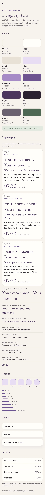
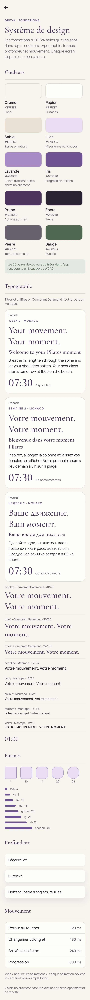
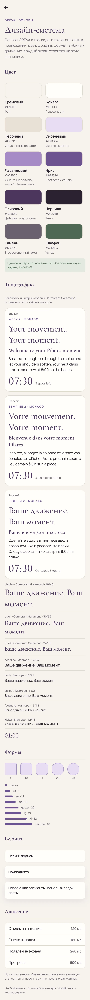
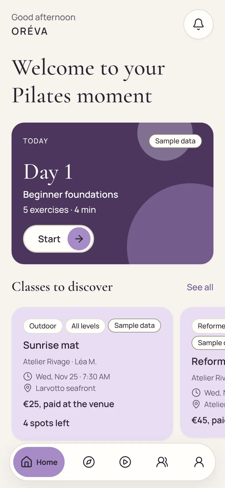
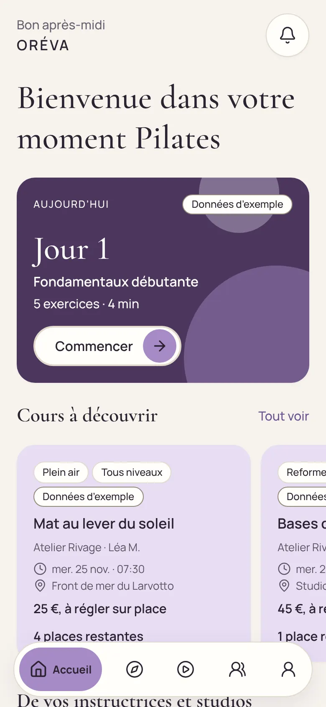
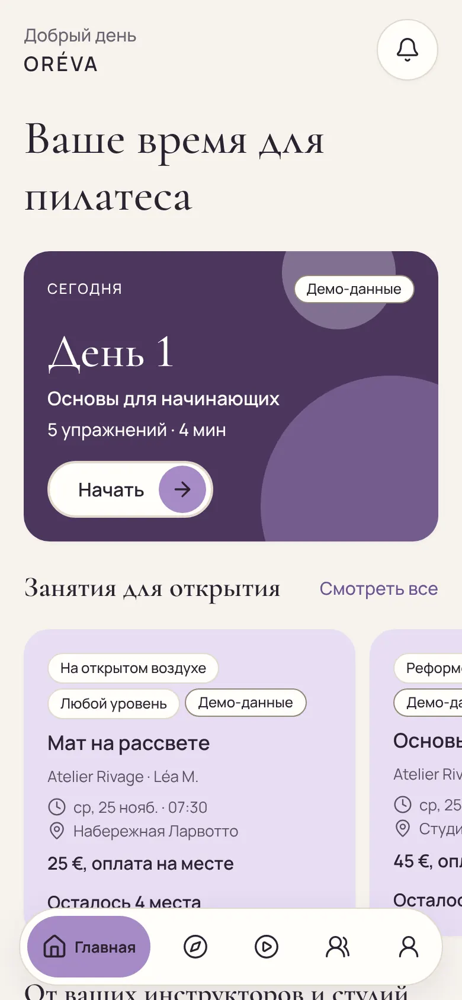

# Design phase A report · Foundations

Branch: `phase-a/design-foundations` · Date: 24 November 2026
Scope: phase A of the design direction approved on 24 November 2026 (decisions P-14, C-5 to C-8). Phases B, C and D start only after the founders' review on iPhone.

Phase A changes the **foundations only**: colors, typefaces, type scale, spacing, radii, elevation and motion tokens, plus the living style guide. No screen was redesigned. Existing screens pick up the new tokens automatically, so the app already looks warmer, but cards, buttons and the tab bar keep their current shapes until phase B.

## What changed

| Area | Change |
| --- | --- |
| Palette | Cream, paper, sand, lilac, mist, lavender, iris, plum, ink, stone, sage. Mint and orchid removed. `packages/tokens/src/palette.ts` |
| Semantic colors | Remapped to the new palette, plus `textBrand` (plum titles), `actionPrimary` and `textOnAction` (plum button, cream label), `progress` (iris). The three card tints keep their legacy names (`tileMint`, `tileViolet`, `tileOrchid`) until phase B replaces tinted cards; they now resolve to sand, lilac and mist. |
| Contrast | 36 text and background pairings, all tested for WCAG 2.2 AA. Two findings fixed on the way: stone on lilac is 4.4996:1 (just under AA), so meta text on selected chips uses the darker stone; sage is darkened from `#55705A` to `#4E6853` to pass on its own surface. |
| Typefaces | Manrope (interface) and Cormorant Garamond (titles and numerals). Onest removed from the app and the portal. Fonts are imported one weight at a time, so only the 7 files used are bundled (2.3 MB); importing the package index would have added every weight and italic (about 5 MB for Cormorant alone). |
| Type scale | `display`, `title1`, `title2` and the new `numeral` / `numeralSmall` use the serif; `kicker` is new (uppercase, tracked). The serif is never below 22pt and always uses lining figures, because its default old-style "1" reads as "I" ("Day 1"). |
| Layout tokens | Gutter 20, section rhythm 40 / 56; radii 4 / 10 / 14 / 22 / 28 / pill; warm plum-tinted shadows; motion durations, stagger, easing and press scale. |
| Style guide | Profile → **Design system** (development and staging) replaces the typeface comparison: palette, contrast summary, type samples in EN, FR and RU, scale, shapes, depth and motion. |
| Navigation | The two screens that show a header (Language, Design system) get a cream header instead of white. No route or structure change. |
| Docs | Visual reference section 0, decision record (P-14, C-5 to C-8), iPhone guide, README |

## Cyrillic check

* **In the font files:** every character used in the app's French and Russian strings exists in all three Cormorant Garamond weights (974 glyphs each).
* **Rendered:** the Russian specimen and the Russian Home screen below, in the web build. On the iPhone itself: to be confirmed by the founders.

## Tests and checks

| Check | Result |
| --- | --- |
| `pnpm check` (lint, typecheck, tests, 18 turbo tasks) | Passes |
| Token tests | 52 (were 34): every contrast pair, serif only from 22pt, lining figures on every serif style, bundled typeface for every style, no mint or orchid, moodboard colors kept, radii and motion limits |
| Mobile tests | 96 (were 89): new style-guide tests in three languages, contrast summary, font mapping in `AppText`, bundled fonts and no Onest |
| EN / FR / RU parity | Passes, with the plural forms each language needs |
| Web export | Bundles; only the 7 font files in use |

## Screenshots (web build, iPhone width)

| Design system (EN) | Design system (FR) | Design system (RU) |
| --- | --- | --- |
|  |  |  |

Existing Home screen with the new tokens, no redesign yet:

| EN | FR | RU |
| --- | --- | --- |
|  |  |  |

## Not verified here

* The iPhone itself: font rendering, colors on the device's display. Reload the development build (no new build needed: fonts load with the JavaScript update) and open Profile → Design system.
* Android: not built in this phase.

## Not in phase A (planned)

* Home renamed Today, new buttons, chips, tags, tab bar, covers, Voile, La Ligne, custom icons: phase B and C.
* Motion: phase D.
