# Design phase B report · Components and signatures

Branch: `phase-b/design-components` · Date: 24 November 2026
Scope: phase B of the design direction approved on 24 November 2026 (decision P-14). Phase A (foundations) was merged and tested on iPhone. Phase C (screens) starts only after the founders' review of this phase on iPhone.

Phase B builds the **shared components and the ORÉVA signature elements**. Screens are not redesigned: they pick up the new components where they already used the old ones (buttons, chips, tags, rows, the tab bar), and keep their layout until phase C. "Home" keeps its name and its tab label until phase C renames it Today.

## What changed

| Area | Change |
| --- | --- |
| Button | `Button` replaces `PillButton` at all 21 call sites. Variants: **primary** (plum, cream label), **secondary** (plum outline), **paper** (for plum, tinted or photo backgrounds), **accent** (lavender, ink label), **quiet** (sand), **text** (iris link). The old lavender default became primary; the old "light" style became secondary, except the Today card, which uses paper on plum. |
| Chip | Selected: lilac with an iris edge and a heavier label (never color alone), announced as selected. Unselected: paper with a 3:1 edge. |
| Tags | `Badge` becomes a softly square tag (radius 4). The sample data tag is a small uppercase tag on paper, readable on any background. |
| IconButton | Paper with a hairline edge, no shadow; `floating` adds depth for controls over the map (Discover's Near me). Accepts ORÉVA or Lucide icons. |
| Rows | Plain line icons in plum instead of lilac circles, 1.5 stroke; switches use iris. |
| Section header, states | Serif plum titles; "See all" is a 44pt iris link; empty and error states use the secondary button. |
| ProgressRing | Fine iris ring on a hairline track; serif numerals from 96pt. Iris because lavender is 2.66:1 on cream, below 3:1 for graphics. |
| Press feedback | `PressableScale`: every button, chip, cover and tab scales to 0.98 in 120 ms. With Reduce Motion on, a slight dim instead of any motion. |
| Haptics | `haptics.selection` (chips, tabs), `haptics.light` (primary buttons), `haptics.success` (ready for phase D). Off on web; failures are silent. |
| Reduce Motion | One shared listener for the whole app instead of one per component. |
| Cover tints | The demo `tone` field becomes a cover tint: `sand`, `lilac`, `mist` (were `tileMint`, `tileViolet`, `tileOrchid`). Same colors, clearer names. |

### Signature elements

| Element | What it is |
| --- | --- |
| **La Ligne** | The signature wave: two sines with different periods, so it never looks mechanical. Three uses: under editorial titles, under the active tab, and as program progress with a dot per step. Decorative uses are hidden from screen readers; the progress form is a labelled progress bar. |
| **Voile** | Two soft gradients crossing, with a faint Ligne. The temporary visual for covers until real photography, used with documented permission, exists. It shows no place and no person. Four tints: lilac, sand, mist, plum. Every stop is opaque and listed in `@oreva/tokens`, and the tests check title and meta text against each stop. |
| **EditorialHeader** | Kicker, serif display title, La Ligne, intro. For the top of main screens in phase C. |
| **EditorialCover** | A Voile with kicker, serif title, meta, an optional tag and button. The whole cover is one button when it opens something. The line sits between kicker and title, never under text. |
| **Icons** | 12 ORÉVA icons on a 24 grid, one 1.5 stroke, round ends: today, discover, practice, connect, profile, play, pause, complete, lotus, mat, breath, near me. Lucide stays for utilities (chevrons, close, clock). |
| **Tab bar** | A paper capsule floating above the content. ORÉVA icon and label on every tab; the active tab is plum, heavier and marked with La Ligne. Labels at 11pt (the system tab size) so "Сообщество" and "Communauté" fit; they grow with the system text size up to 1.3×, then stay on one line. Selection haptic. Same tab order, routes, test IDs and spoken labels. |

## Accessibility

* Contrast: 39 text and graphic pairings tested (were 36). New: the sample tag, plum titles on lilac, the plum button edge and active tab line. Plus title and meta text at every stop of the four voiles.
* Selection is never shown by color alone: chips and tabs change weight and edge, and screen readers announce "selected".
* Touch targets stay at 44pt or more (buttons, icon buttons and tabs are 52pt).
* Icons are decorative: the control that holds them carries the spoken label.
* Reduce Motion: no scale on press, only a dim.

## Tests and checks

| Check | Result |
| --- | --- |
| `pnpm check` (lint, typecheck, tests, 18 turbo tasks) | Passes |
| Token tests | 61 (were 52): new contrast pairs, text readable at every voile stop, voile stops are opaque palette colors |
| Mobile tests | 114 (were 96): buttons (haptic on primary only, disabled, plum and lavender labels), chips (selection state and haptic), press scale and Reduce Motion, icon buttons, sample tag, La Ligne geometry and progress bar, Voile, covers (one button, paper text on plum), 12 hidden icons, tab bar (labels on every tab, ORÉVA icons, the line on the active tab, haptic), style guide in three languages |
| EN / FR / RU parity | Passes |
| Web export | Bundles, no console errors |
| Dependencies | None added. `expo-haptics` and `expo-linear-gradient` have been in the app since phase 1. No change to `app.config.ts`, `eas.json` or native code. |

## Screenshots (web build, iPhone width)

Profile → **Design system**, new Components and Signatures sections at the end of the page:

| EN | FR | RU |
| --- | --- | --- |
|  |  |  |

Existing screens with the new components and tab bar (layouts unchanged until phase C):

| | EN | FR | RU |
| --- | --- | --- | --- |
| Home | 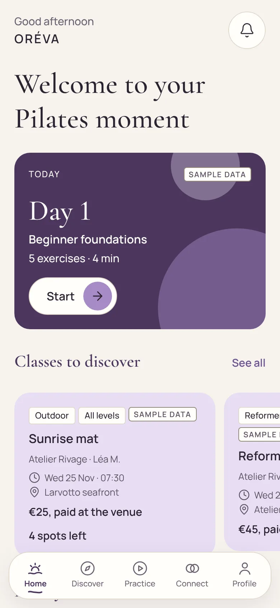 | 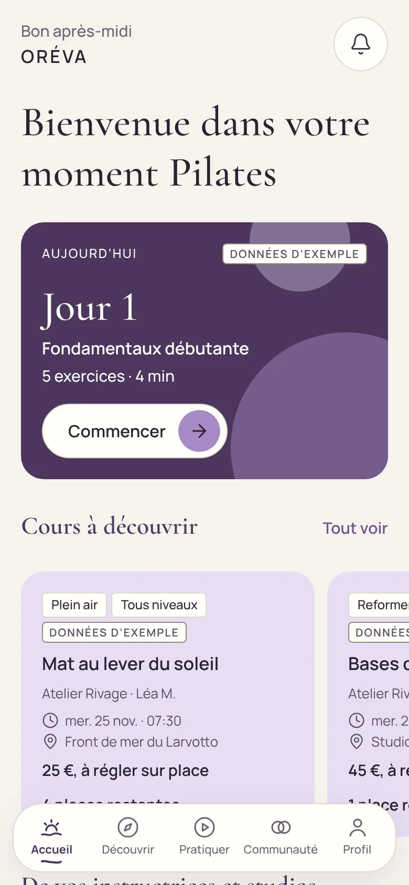 | 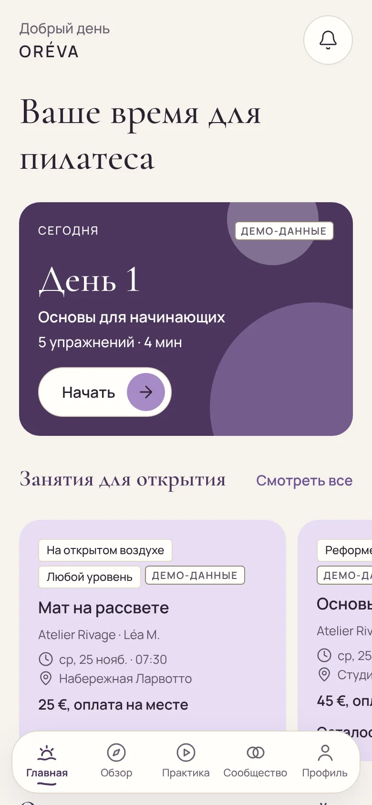 |
| Discover | 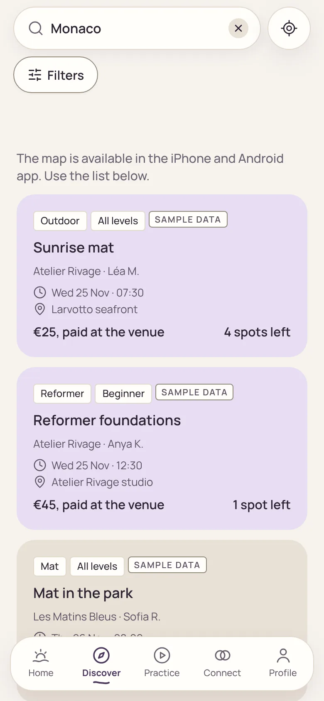 | 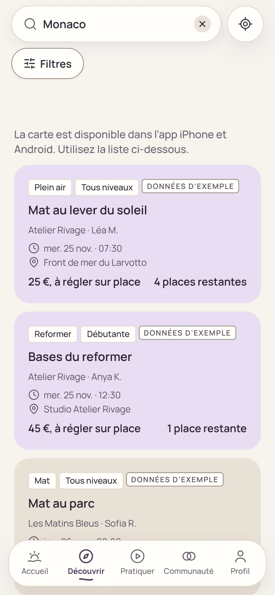 | 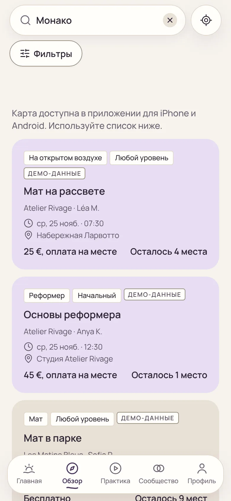 |
| Practice | 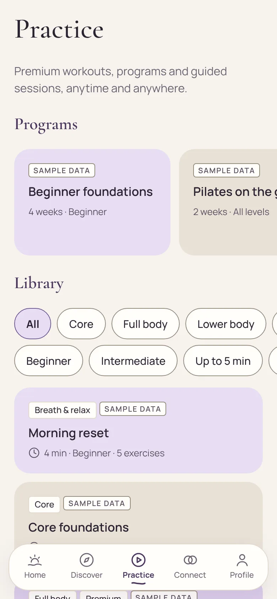 | 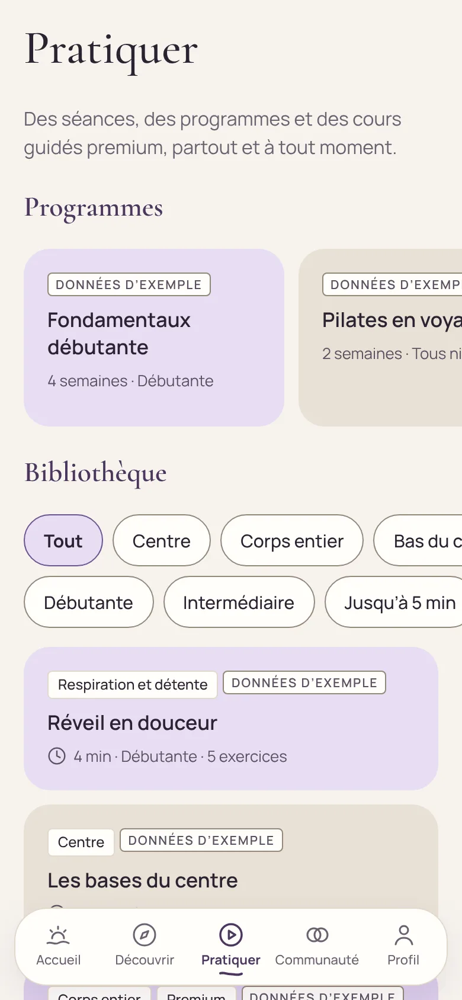 | 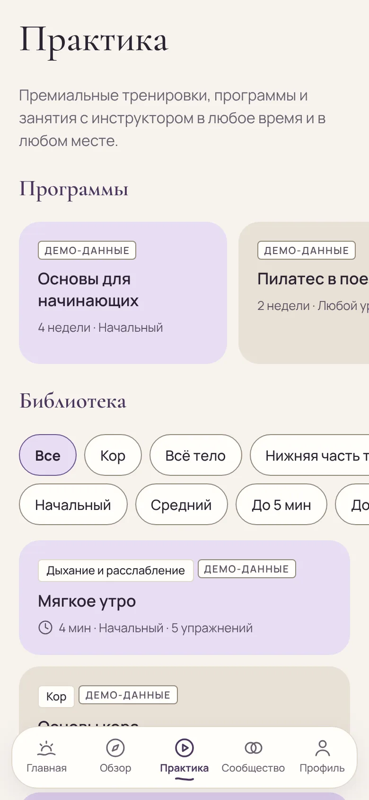 |
| Connect | 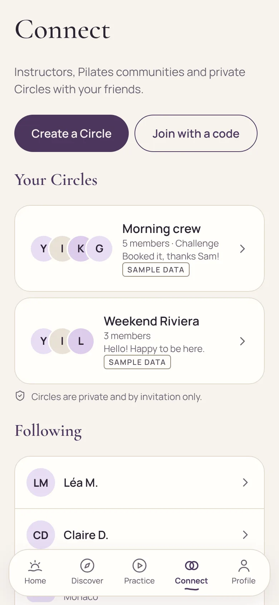 | 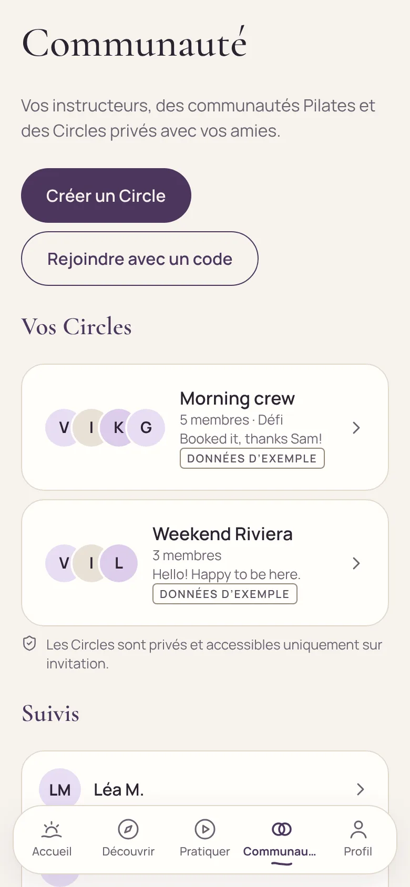 | 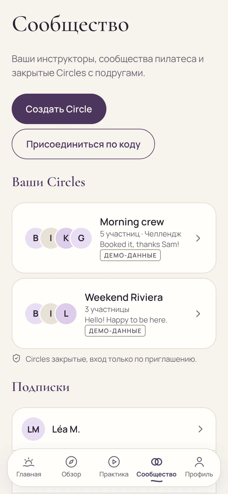 |

## Not verified here

* **The iPhone itself:** press feel, haptics (they only exist on a device), gradients and the tab bar above the home indicator. Reload the development build; no new build is needed.
* **Switch color on web:** the web build draws the switch thumb in its own teal. On iPhone the thumb is white on an iris track.
* **Tab label shrink:** on iPhone, a label that is still too long shrinks to 85% before it is cut. The web build cannot shrink text, so it would cut it instead; at 390pt wide none is cut.
* Android: not built in this phase.

## Not in phase B (planned)

* Phase C: Home becomes Today; screens adopt EditorialHeader, EditorialCover and the icons (for example Discover's Near me and filter buttons, the Today card, program covers).
* Phase D: entrance and progress motion, the success haptic at the end of a session.
