# Practice, editorial direction · report

Branch: `practice/editorial` · Date: 26 November 2026
Scope: Practice only, the second screen family of the editorial direction, after Today (PR #14). Discover, Connect and Profile keep their current look.

## What Practice is now

1. **The Practice tab.** A large serif title and two views, Programs and Sessions, on a short iris rule that slides between them on a spring. The view fades in and rises when it changes.
   - **Programs are magazine chapters.** Each one is a 4:5 photograph with a paper caption laid over its lower edge: the chapter number in serif (01, 02, 03), weeks and level, the title, and the program's **real progress** on this phone ("1 of 5 sessions") on a thread that grows to its value.
   - **Sessions are a photographed library.** Each session has a 4:5 photograph, its focus, title, length, level and exercises. Filters are pill chips. When nothing matches, a "Clear filters" link appears.
2. **The program page.** The program's photograph runs edge to edge with a round back button, and a cream sheet is laid over it. The sheet holds the title in serif, the description and the progress ("Program progress · 1 of 5 sessions"). The **schedule is a path**: a fine vertical thread with a mark for each day.
   - A day finished on this phone has a filled iris mark and a check. The next day has an iris ring and reads "Up next". Rest days are quieter.
   - Each session day shows its photograph.
   - The one action stays at the bottom of the screen and follows the member: "Start the program", "Continue · Day 2", or "Start again" once every day is done.
3. **The session page.** The session's photograph, then the title in serif and the description. Level, duration and equipment sit on a strip between two hairlines (never calories, P-15). Below come the instructor and audio language, and the exercises numbered 01 to 06 in serif with their times. **Start** (or **Resume**) stays within reach at the bottom.
4. **The immersive player.** It rises over everything as a full-screen modal, with no swipe that could end a session by accident.
   - The video runs edge to edge. A close button and the "Sample video" label sit on top of it.
   - A paper sheet holds:
     - a progress line made of **one segment per exercise**, sized by its length; the current segment glides second by second while playing;
     - "Exercise 1 of 5", the exercise in serif (it changes with a short fade);
     - the timer in large serif, the next exercise, and three controls.
   - **The controls never hide**, so the timer stays readable and VoiceOver and Switch Control always reach them. This is a deliberate choice: readability before effect.
5. **The completion.** The session's photograph sits in a circle, and a fine iris ring closes around it (under a second). Then come "Session complete", **Bravo** in serif and **La Ligne** drawing itself under it. Below are the real numbers (exercises, minutes; never calories) and Done. There is one success haptic.

**La Ligne** appears once in Practice, on the completion screen: Today's greeting and the end of a session are its two moments.

## Honest data

* Program progress counts only sessions finished on this phone.
* **Fixed:** a program can repeat a session. "Beginner foundations" has Morning reset on day 1 and day 7. Before, finishing it once marked both days done ("2 of 5" after one session). Now each time a session is finished counts for one day, in order (`programProgress.ts`, unit-tested).

## Sample videos, redrawn

The three bundled sample videos were landscape, in green and bright violet, outside the palette. They are now portrait (720 x 1280, for the full-screen player). They are calm breathing animations in cream, lilac, mist, sand and iris, drawn for ORÉVA (`tools/photography/sample_videos.py`): no third-party footage, still labelled "Sample video". They total 368 KB (they were 146 KB). Real classes replace them with the video provider (O-10).

## Photographs

No new photographs. On `pg-on-the-go` (the arch over the sea), a small security camera on the wall became visible once the photograph was shown full width. It was removed by the same plain-wall retouch as the Today photograph (`docs/design/photography.md`).

## Shared editorial components (from Today)

`EditorialHero` (photo with settle, parallax, stretch), `ProgressThread`, `RoundButton`, `EditorialTabs`, `StickyAction`, `FactStrip`, `DetailLayout` (photo, back button, sheet, sticky action) now live in `apps/mobile/src/ui/editorial/`. Today uses the first two; it looks and behaves exactly as before.

## Motion and Reduce Motion

| Moment | Motion | With Reduce Motion |
| --- | --- | --- |
| Tabs | The rule slides on a spring with no bounce; the view fades in and rises 14 pt | The rule moves at once, the view is simply there |
| Program progress | The thread grows to its value in 600 ms | Drawn at its value |
| Program and session pages | The photograph settles from 104% to 100%, moves at 35% of the scroll speed, grows when pulled; blocks rise 70 ms apart | Still photograph, blocks shown at once |
| Player | The sheet rises; the current segment glides; the exercise name fades in | Segments jump to their value, no fade |
| Completion | Ring closes (950 ms), photograph fades in, words rise, La Ligne draws | Everything already there; the haptic stays (it is not motion) |
| Presses | Cards, buttons and controls give under the finger on a firm spring | A slight dim |

Every animation runs on the UI thread (Reanimated). Nothing waits for an animation, and nothing is fake loading.

## Tests and checks

| Check | Result |
| --- | --- |
| `pnpm check` (18 turbo tasks), `pnpm format:check` | Pass |
| Mobile tests | 161 (were 148). New: progress counted once per finish, in order; chapters with real progress; views announced as tabs with selected state; "Clear filters"; program page "Continue · Day 2" and Up next; "Start the program" before any session; spoken back button and decorative photograph; Resume; player close and session progress value; Up next hidden on the last exercise; completion with real numbers, ring and La Ligne, with and without Reduce Motion. All earlier Practice tests are unchanged and pass. |
| i18n | New keys in EN, FR, RU with every plural form |
| Native fingerprint | `e3776e1e…`, the same as the ORÉVA Preview build installed for Today: **no new build needed after the merge**, it arrives as an update |
| Web export | Bundles, no console errors |

## Screenshots (web build, standard iPhone 393 x 852 unless noted)

| Practice · Programs | Scrolled | Sessions |
| --- | --- | --- |
| 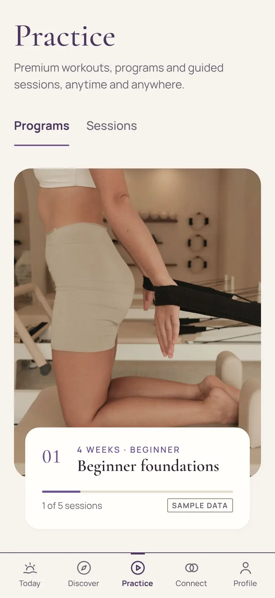 | 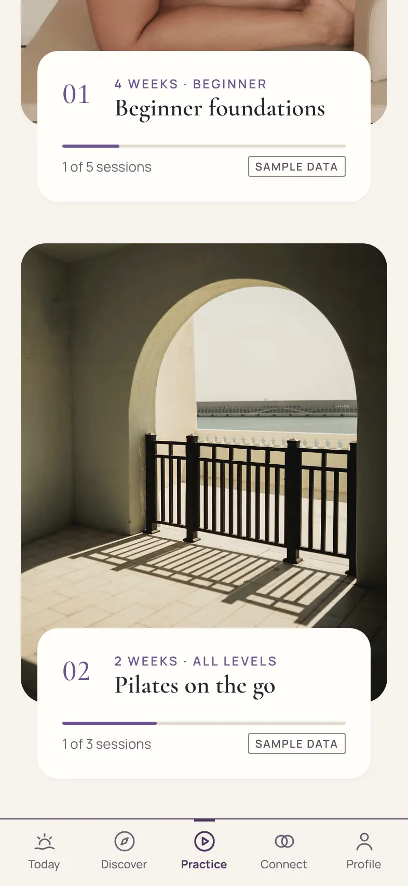 | 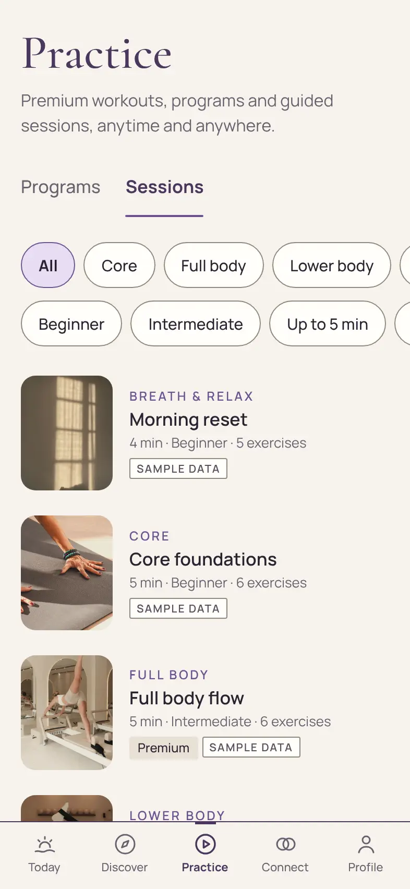 |

| Program | Its schedule | Session | Its exercises |
| --- | --- | --- | --- |
| 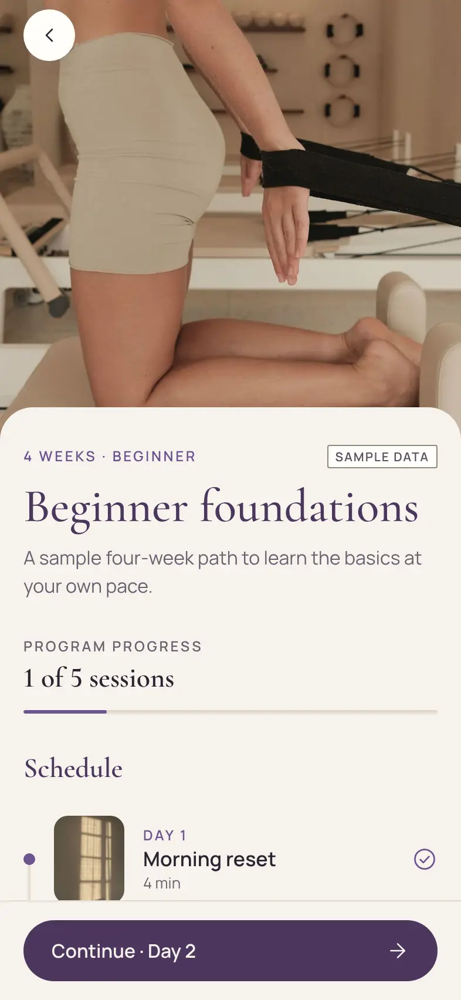 | 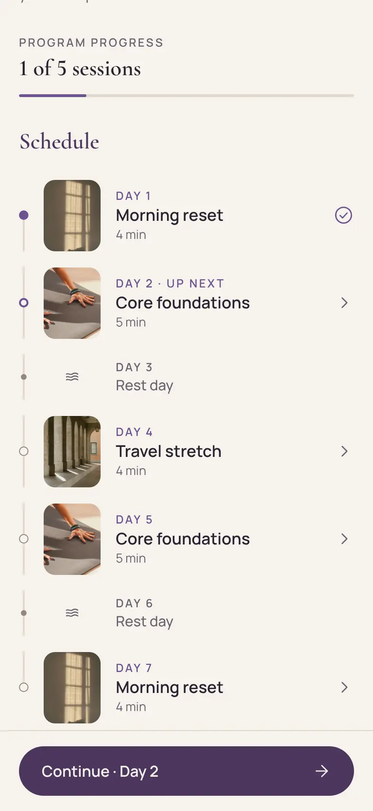 | 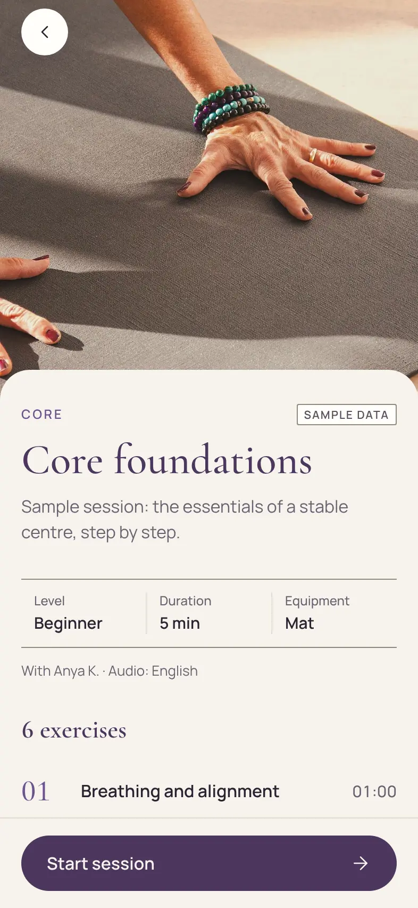 | 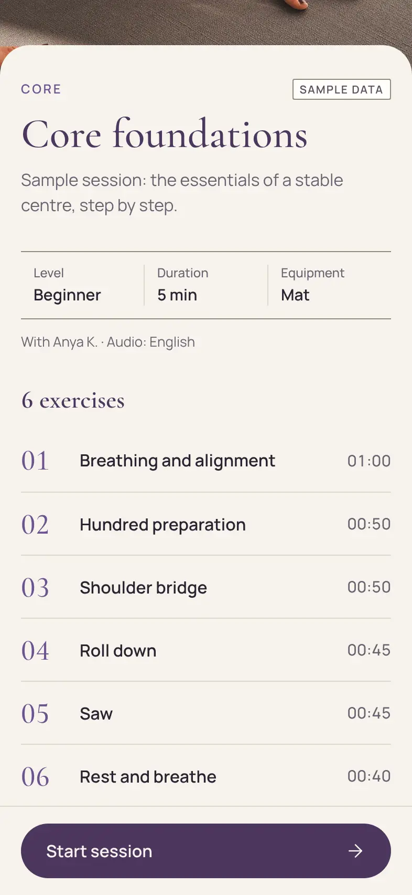 |

| Player | Completion | FR | RU |
| --- | --- | --- | --- |
| 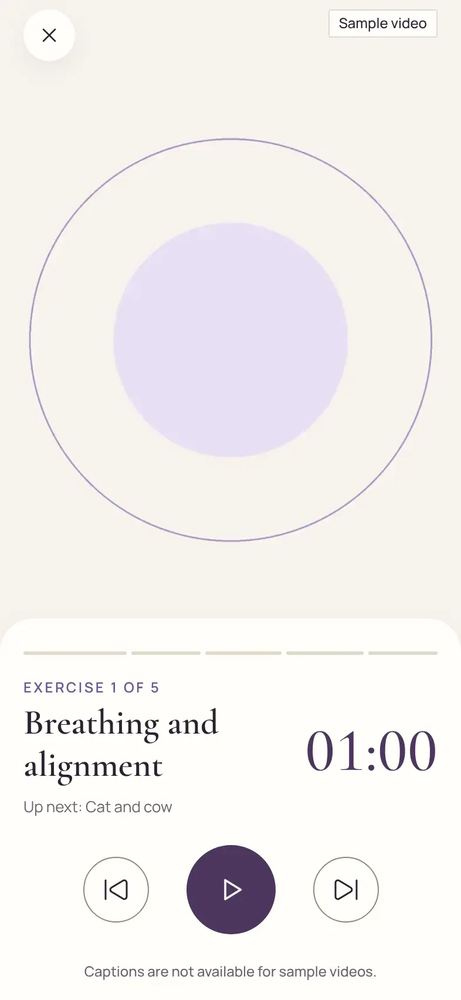 |  | 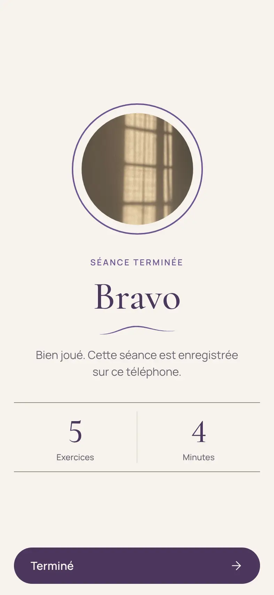 |  |

| iPhone SE · Practice | SE · Program | SE · Player | Pro Max · Session | Pro Max · Player |
| --- | --- | --- | --- | --- |
| 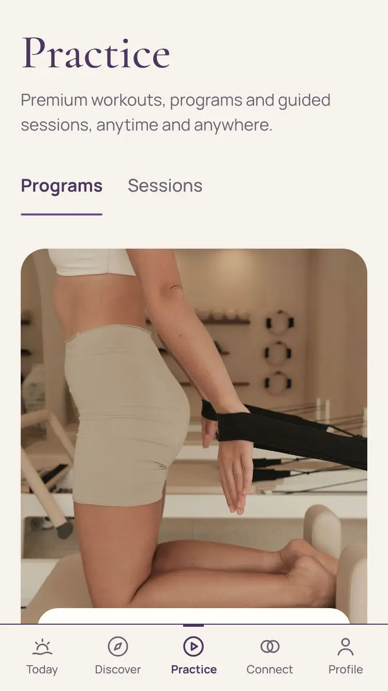 | 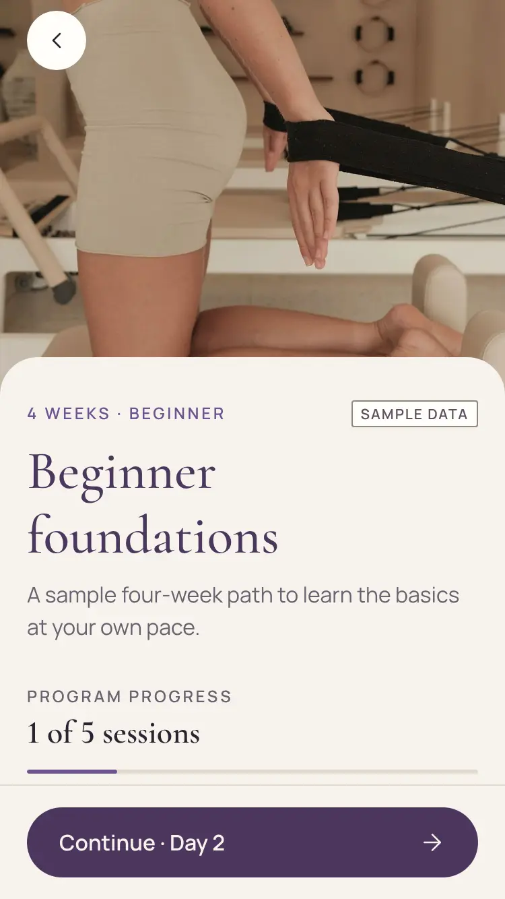 | 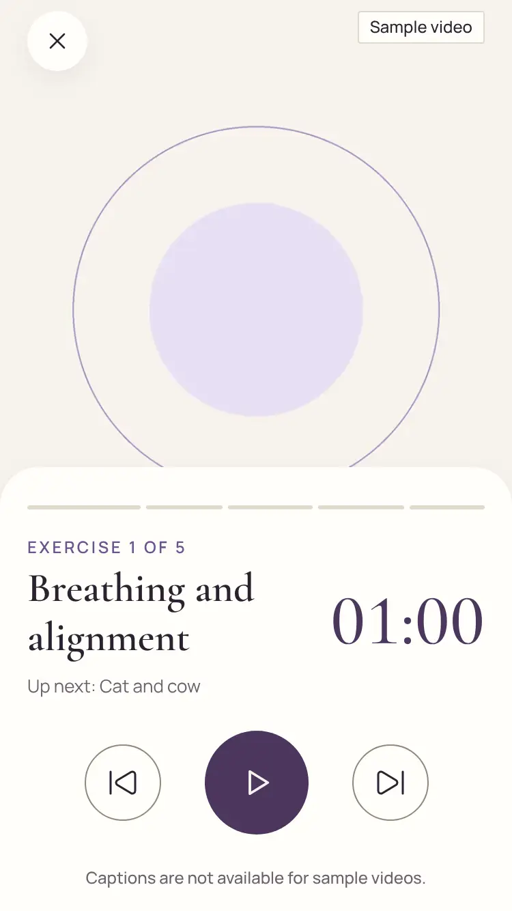 | 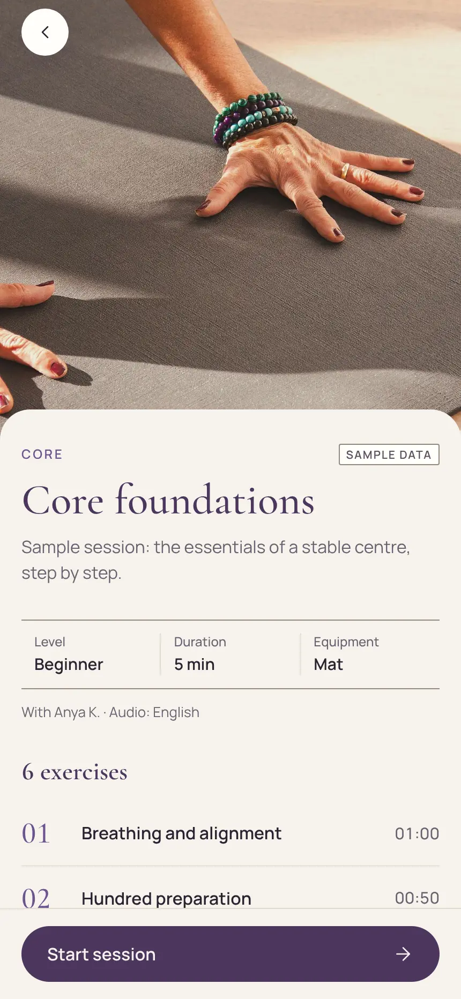 | 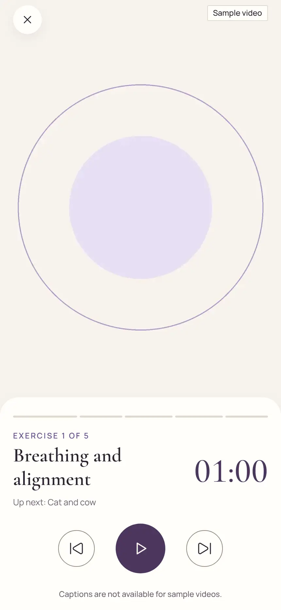 |

Also: [Practice FR](screenshots/practice-std-fr.webp), [Practice RU](screenshots/practice-std-ru.webp), [Player FR](screenshots/player-std-fr.webp), [Player RU](screenshots/player-std-ru.webp), [Practice Pro Max](screenshots/practice-max-en.webp).

## Not verified here

* The feel on the iPhone: the tab rule spring, the segment glide, the ring closing, the full-screen modal rising, 120 Hz scrolling. The web build shows layout, not native motion.
* The program and session photographs entering from the Practice cover: a true shared-element transition needs Reanimated's shared transitions, which are switched off in this native build (a static feature flag). Turning them on means a new native build; the photograph settling on the new page gives the continuity for now.
* VoiceOver on the device; Android (not built).

## Not changed

Today, Discover, Connect, Profile and the tab bar. Data, business rules, Supabase and navigation are unchanged. The only routing change is the player, now a full-screen modal.
