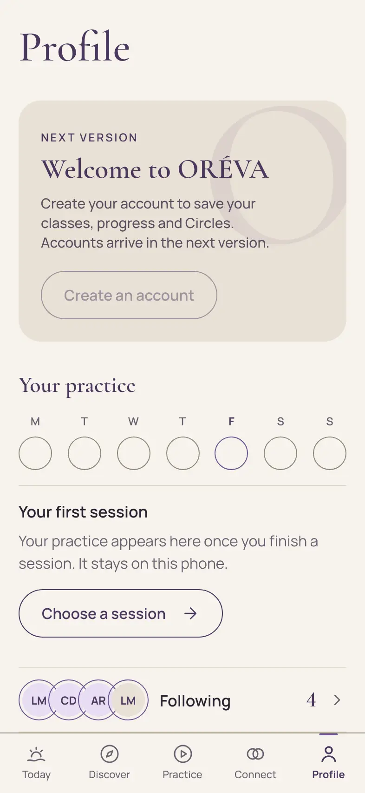
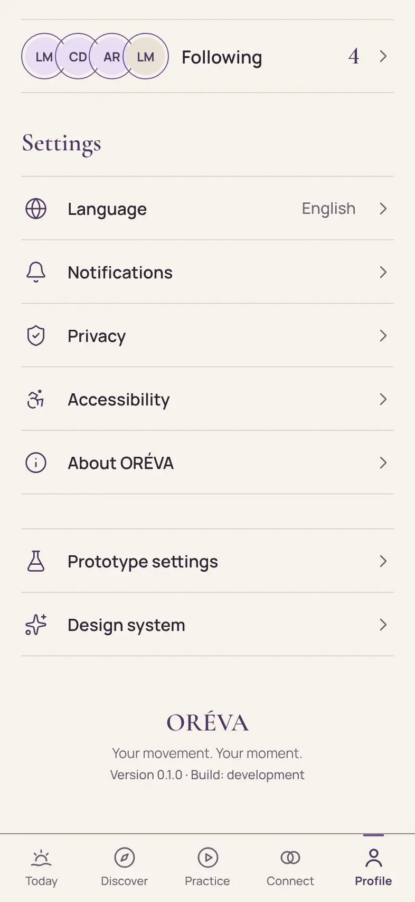
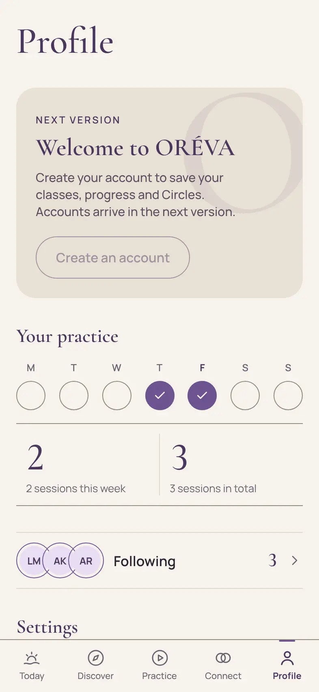
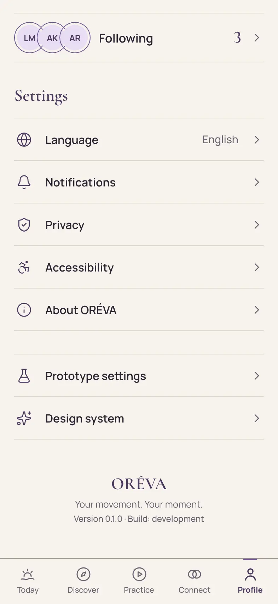
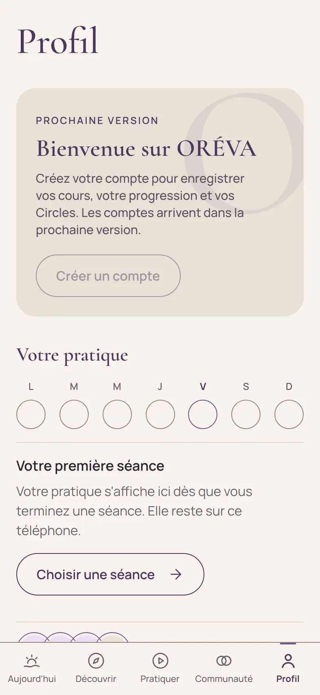
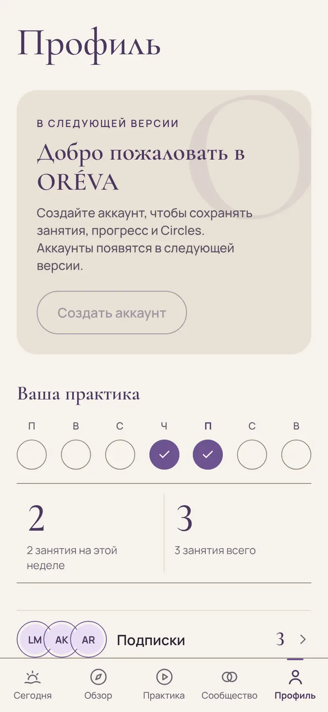
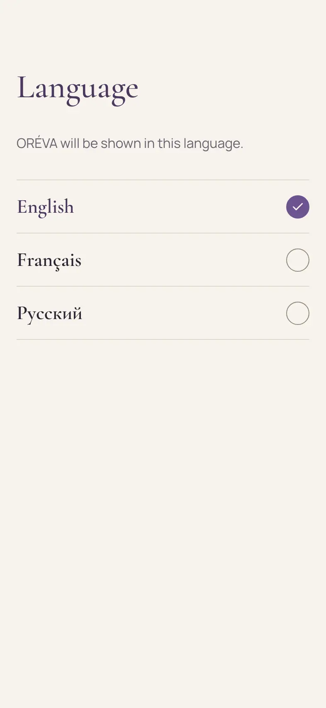
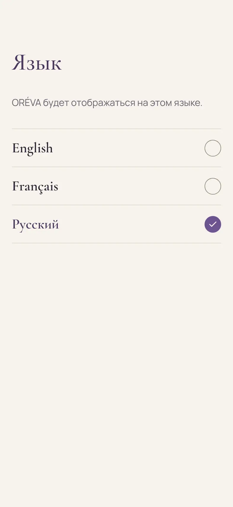
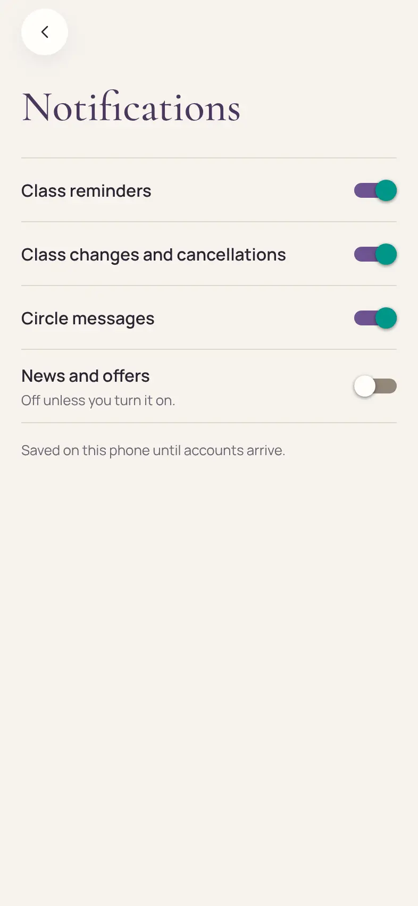
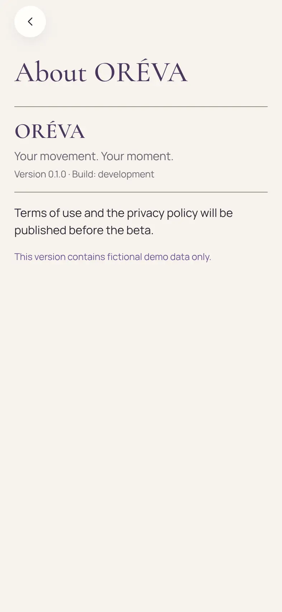

# Profile and settings, editorial direction · report

Branch: `profile/editorial` · Date: 27 November 2026
Scope: Profile, the five settings pages (Notifications, Privacy, Accessibility, About, Prototype) and the Language page. With this PR every screen of the app is in the editorial direction.

## What changes

1. **Profile.**
   - **A large serif title**, then **the membership card**: sand, with ORÉVA's "O" as a very large serif drop cap, tone on tone, cut by the card's edge. "Next version", "Welcome to ORÉVA", what an account will keep, and **Create an account shown disabled**. Accounts arrive in the next version, and the card says so.
   - **Your practice: the week as seven rings** under the day initials. These replace the cut-paper stones of C-9.
     - A day with a session finished on this phone fills in iris with a check, as a small spring when the screen opens.
     - Today is ringed in iris.
     - Before the first session, there is an invitation instead of zeros, as before.
     - After it, **two large serif numbers**: this week and in total, from this phone only.
   - **Following:** one row with the monograms of who you follow, laid side by side like seals, and the count. It opens Connect.
   - **Settings** sit on fine rules, with no boxes. The prototype tools are in their own group (never in production).
   - The footer: ORÉVA in serif, the tagline, the version.
2. **Settings pages:** the round back button, the title in large serif, rows on fine rules. Prototype settings use pill chips.
3. **Language:** the title in serif and each language in its own name, in serif, on a fine rule. The chosen one has an iris disc with a check and is announced as checked. Changing language gives a selection haptic (none when the same language is tapped).

## Accessibility fixes found on the way

* **"1 session this week" was read twice** by VoiceOver: once on the week, once on the number. Now it is said once: by the week before the first session, and by the numbers after (the rings are then decorative).
* **Monogram initials at small sizes** overflowed their circle. The serif is never set under 22 pt (our type rule), so seals under 52 pt now use the sans; from 52 pt the serif is set at 22 pt. This also tidies the member seals on a Circle's page.

## Shared changes

* `LinkRow` and `ToggleRow`: rows on fine rules aligned with the page's text, without boxes. A press dims the row instead of tinting it.
* `ScreenHeader` (used by loading states) uses the round paper back button.
* New components: `WeekRings` in `src/ui/editorial`, and `SettingsPage` for the settings pages.
* One new colour pair is checked for AA: the cream check on iris.

## What is left from C-9

`WeekStones`, `CutShape`, `EditorialCover`, `EditorialHeader`, `Masthead`, `FactList`, `UnderlineTabs` and `Line` are no longer used by any screen, only by the design-system preview and their own tests. They can be removed in a short clean-up PR once the founders confirm the direction is final. `expo-linear-gradient` can go with the next native change.

## Tests and checks

| Check | Result |
| --- | --- |
| `pnpm check` (18 tasks), `pnpm format:check` | Pass |
| Mobile tests | 188 (were 179), the same three runs in a row. New tests check: <ul><li>the week: only finished days filled, today ringed (not once filled), with and without Reduce Motion, decorative next to the numbers;</li><li>Profile: serif title and card, with Create an account disabled; the real numbers said once; Following as one button with its count;</li><li>settings: a serif title and a spoken back button;</li><li>Language: the selection haptic only when the language changes.</li></ul>All earlier Profile, Language and settings tests are unchanged and pass. |
| Token tests | 64 (one new pair) |
| Native fingerprint | `e3776e1e…`, unchanged: no new build needed after the merge |
| Web export | Bundles, no console errors |

## Screenshots (web build, standard iPhone unless noted)

| Guest | Guest, below | After sessions | Below |
| --- | --- | --- | --- |
|  |  |  |  |

| FR | RU | Language | Language RU | Notifications | About |
| --- | --- | --- | --- | --- | --- |
|  |  |  |  |  |  |

Also: [Privacy FR](screenshots/privacy-std-fr.webp), [iPhone SE](screenshots/profile-guest-se-en.webp), [Pro Max](screenshots/profile-active-max-en.webp).

On the web, switches use the browser's colours; on the iPhone they use iris (`trackColor`), unchanged.

## Not verified here

* The week's days filling in, on the device.
* The Language page as a modal sheet on iOS.
* VoiceOver on the device; Android.
