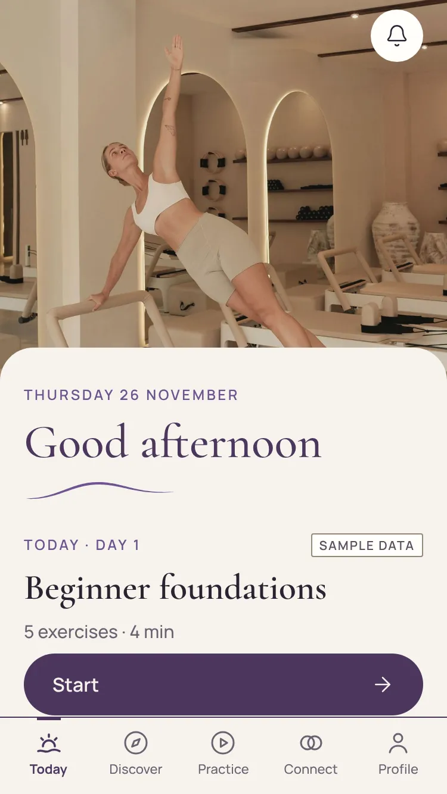
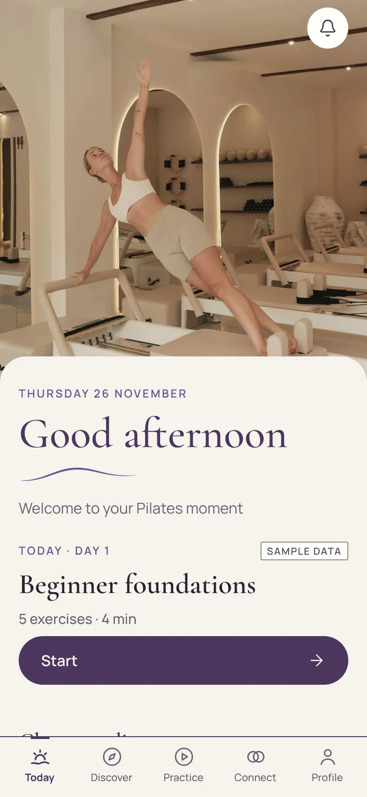
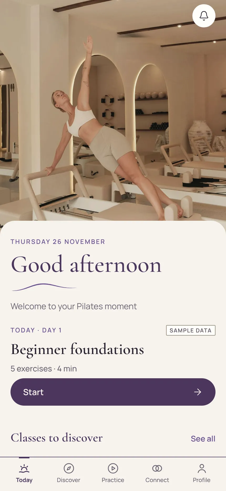
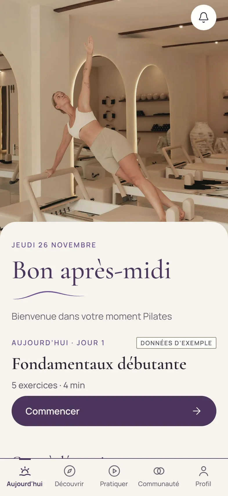
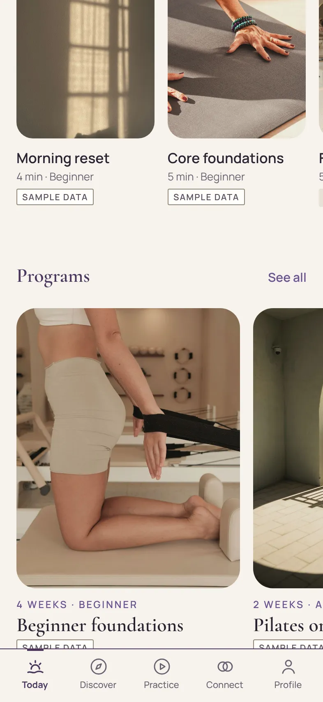

# Today, editorial direction · report

Branch: `today/editorial-v2` (PR #14) · Date: 26 November 2026
Scope: Today only, first screen of the premium editorial direction approved on 26 November 2026. Other screens keep their current look until Today is approved.

## What Today is now

1. **One photograph, edge to edge**, under the status bar: the Pilates studio of the Roxana Popovici series. It settles from 104% to 100% as the screen opens (0.8 s), moves at 35% of the scroll speed for depth, and grows when pulled down instead of showing a gap. All on the UI thread (Reanimated).
2. **A cream sheet laid over it**, 28 pt corners: the date, the greeting in large serif, **La Ligne** drawing itself under it (0.9 s, once), the welcome line.
3. **Today's session and its one action**: "TODAY · DAY 1", the program in serif, exercises and minutes, a plum **Start** pill. Visible without scrolling on every iPhone, the SE included (on screens under 700 pt the welcome line gives way to it).
4. **Rails**, each resting on a card edge with the next card peeking in:
   - **Classes nearby**: text cards with the time in large serif. No photograph: a partner's class never wears a stock picture (decision C-8).
   - **Sessions for you**: 4:5 photographs, category chips.
   - **Programs**: large 4:5 covers.
5. **Motion**: blocks fade in and rise 14 pt, 70 ms apart, first five only, under half a second; cards give under the finger on a firm spring; photographs fade in over 250 ms once decoded.
6. **Reduce Motion**: a still photograph, no parallax, blocks shown at once, La Ligne already drawn, presses dim instead of scaling.

## Photographs

Ten photographs, selected, verified, graded and credited: see `docs/design/photography.md` (art direction, selection, verification, credits). 1.4 MB in all, bundled with the app, cached by expo-image.

## Performance

* Every animation runs on the UI thread (Reanimated worklets): scroll, parallax, presses, entrances. The JavaScript thread only renders.
* Photographs are bundled (no network), sized at 3x what is shown, decoded off the main thread by expo-image and cached in memory and on disk.
* Rails are short (at most six items); nothing waits for an animation.
* To confirm on the iPhone: scrolling at 120 Hz on a ProMotion iPhone, and the first opening time.

## Tests and checks

| Check | Result |
| --- | --- |
| `pnpm check` (18 turbo tasks), `pnpm format:check`, mobile tests without NODE_PATH | Pass |
| Mobile tests | 148 (were 139): decorative photograph and hidden signature, one Start action, class cards labelled and without stock photographs, same render with Reduce Motion, La Ligne geometry, every slot filled and credited, photographs only for ORÉVA's own content, weight budget (under 400 KB each, under 2 MB in all) |
| Tokens | 60: editorial springs close to critical damping (no visible bounce) |
| Web export | Bundles, no console errors |

## Screenshots (web build)

| iPhone SE (375 x 667) | Standard (393 x 852) | Pro Max (430 x 932) |
| --- | --- | --- |
|  |  |  |

| FR | RU | Rails (EN) |
| --- | --- | --- |
|  |  |  |

## Not verified here

* The real feel on the iPhone: parallax, springs, La Ligne drawing, 120 Hz scrolling. The web build shows layout and photographs, not native motion.
* Android: not built.

## Trying it before the merge

The branch is also pushed as `preview/today-editorial`, which starts an ORÉVA Preview build of it (`.github/workflows/eas-build-preview-branch.yml`). Install it from expo.dev (project, Builds) or from the link in the GitHub Actions run summary. PR #14 is not merged until the founders approve it.
