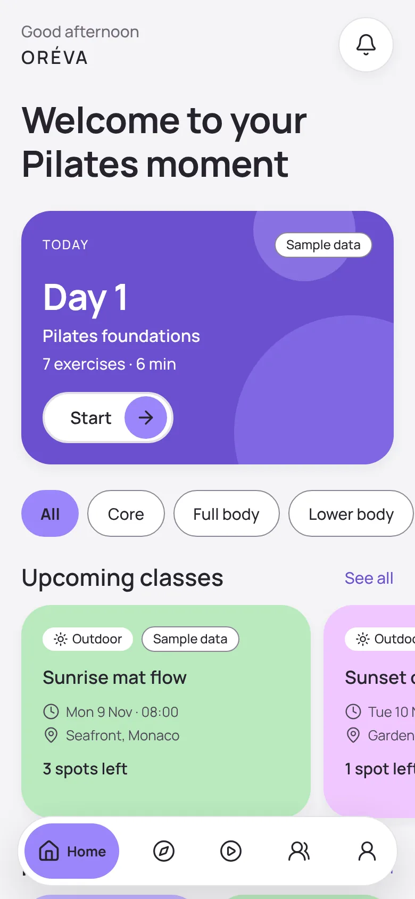
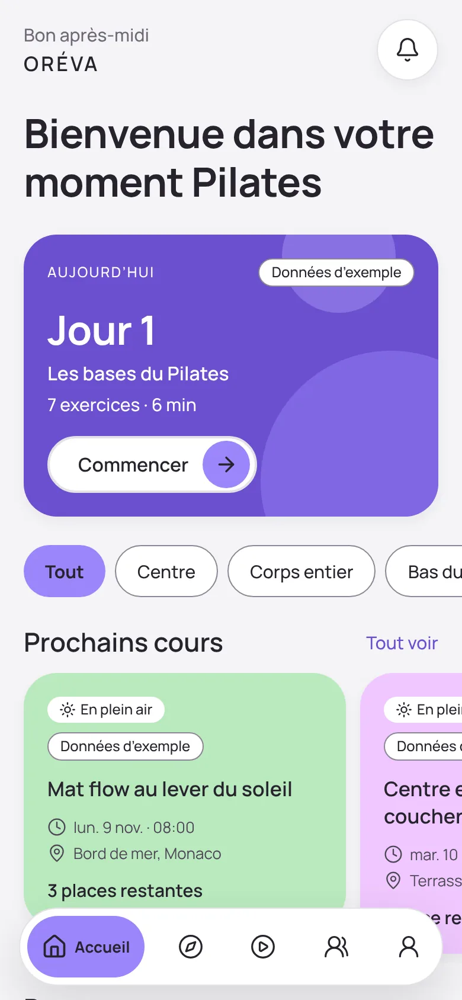
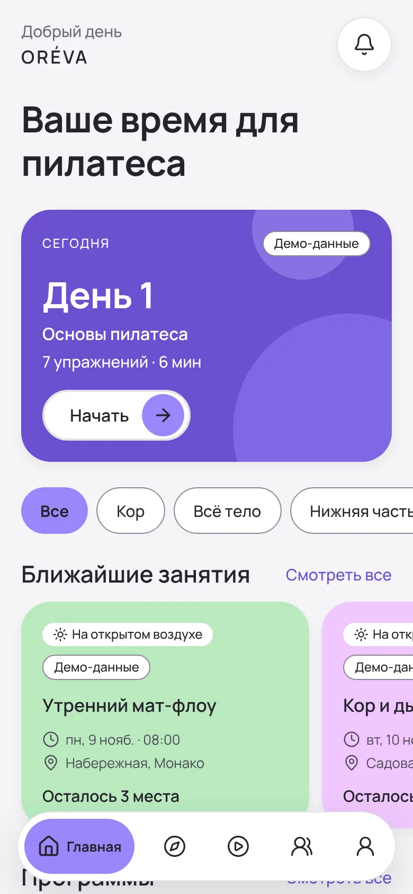
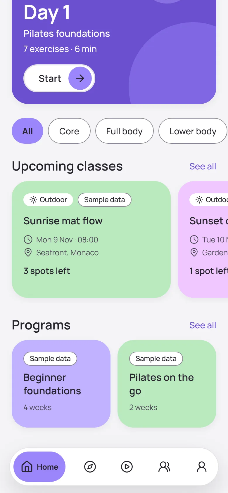
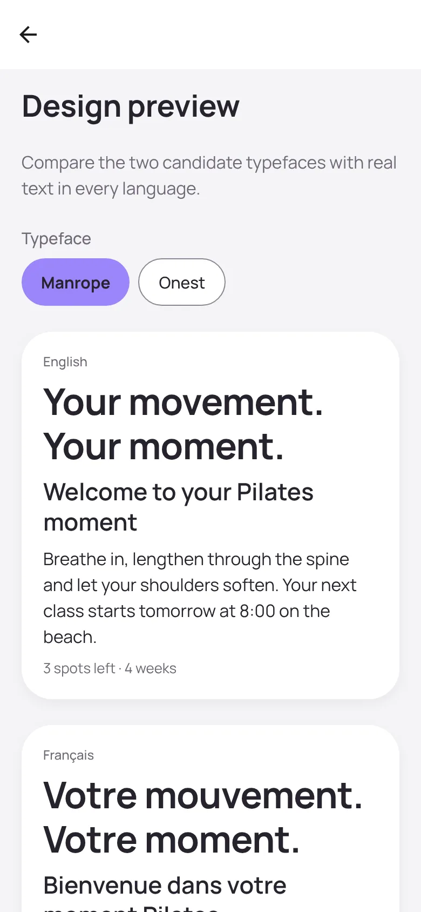
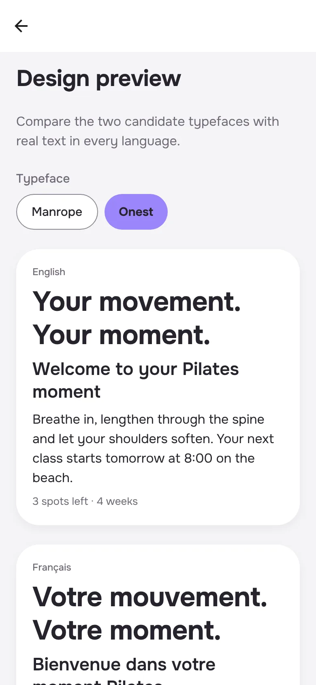

# Phase 1 report · Foundation

Branch: `phase-1/foundation` · Date: 8 November 2026

## Objective

Set up the technical foundation so every later phase builds on solid ground:

- the monorepo
- strict TypeScript, lint, tests and CI
- the design system from the visual reference, with accessibility fixes
- EN/FR/RU from day one
- navigation by pillar
- a static Home faithful to the reference
- the admin portal shell
- the database foundation with RLS and the placeholder guard

No business features (accounts, bookings, chat, payments, notifications) are included, as agreed.

## What works

| Area           | What was built                                                                                                                                                                                                                                                         | How it was verified                                                                                                                                               |
| -------------- | ---------------------------------------------------------------------------------------------------------------------------------------------------------------------------------------------------------------------------------------------------------------------- | ----------------------------------------------------------------------------------------------------------------------------------------------------------------- |
| Monorepo       | pnpm 10 + Turborepo: `apps/mobile`, `apps/admin`, `packages/{tokens,i18n,core,config}`, `supabase/`                                                                                                                                                                    | `pnpm check` runs lint, typecheck and tests in every package (15 tasks green)                                                                                     |
| Design tokens  | Palette from the reference with AA fixes, type scale, spacing, radii, elevation, motion. Every text/background pairing is listed and checked.                                                                                                                          | 34 tests, including 26 WCAG contrast pairs                                                                                                                        |
| i18n           | EN/FR/RU, first-launch detection, live switching, Intl formatters for dates, prices and distances, pseudo-locale                                                                                                                                                       | 34 tests: key parity, CLDR plural forms per language (RU one/few/many), interpolation variables, time zones and DST, currencies (EUR, GBP, JPY, AED), km vs miles |
| Domain helpers | Localized content resolution with fallback; wall-clock time in a time zone (DST-safe)                                                                                                                                                                                  | 10 tests, including the March clock change in Monaco                                                                                                              |
| Mobile app     | Expo SDK 58, Expo Router. Floating pill tab bar **Home · Discover · Practice · Connect · Profile**. Static Home: greeting, Today card, category chips, upcoming classes, programs. Pillar placeholders. Profile with Language picker. Design preview (non-production). | 19 tests. iOS, Android and web bundles built with Metro. Screenshots in EN/FR/RU. Russian tab labels checked at 375pt and 390pt widths.                           |
| Environments   | `APP_VARIANT` sets bundle ID, name and scheme: `com.oreva.app(.dev/.staging)`                                                                                                                                                                                          | Tests on `app.config.ts`                                                                                                                                          |
| Admin portal   | Next.js 16 shell with tokens as CSS variables, self-hosted fonts, EN/FR/RU via cookie or Accept-Language, security headers                                                                                                                                             | 4 tests. Production build. Browser check: French detected, switch to Russian, httpOnly cookie, `X-Frame-Options: DENY`.                                           |
| Database       | PostGIS, `private` schema, environment marker failing closed to production, **placeholder guard**, `locales` table, localized-text helpers, `platform_roles` with RLS                                                                                                  | 38 pgTAP tests on a local Supabase Postgres 17. Includes project-wide checks: RLS on every table, pinned `search_path`, no private function executable by PUBLIC. |
| CI             | GitHub Actions: formatting, lint, typecheck, tests, admin build, mobile bundles, database migrations + pgTAP, secret scan                                                                                                                                              | Workflow file written. **It has not run yet**; it runs when this PR is opened.                                                                                    |
| Docs           | `CLAUDE.md`, README, i18n guide, environments runbook, decision note 0001                                                                                                                                                                                              |                                                                                                                                                                   |

**Total: 101 unit tests and 38 database tests passing.**

## Screenshots (web build, iPhone-sized viewport)

| English                              | Français                             | Русский                              |
| ------------------------------------ | ------------------------------------ | ------------------------------------ |
|  |  |  |

| Home (scrolled)                                     | Design preview: Manrope                             | Design preview: Onest                           |
| --------------------------------------------------- | --------------------------------------------------- | ----------------------------------------------- |
|  |  |  |

Every content card shows a **Sample data** badge. None of it is Gym & Tonic information.

## Problems found and fixed along the way

- **Russian tab labels were truncated** ("Главн…"). I tightened the tab bar spacing, and labels now fit at 375pt.
- **Private database helpers were executable by everyone.** Postgres grants EXECUTE to PUBLIC by default, and a per-schema default didn't remove it. The new convention test caught it, and the migration now revokes it explicitly.
- **French times rendered as "8:00".** Switched to the locale's standard short time format, so French shows "08:00".

## What is not done, or not verified here

- **No native device run.** This cloud environment has no iOS or Android simulator. Metro bundles for both platforms build, but the app hasn't run on a phone yet. Next step: build an EAS development build and test on your phones. That needs an Expo account (open item O-01 for the organization).
- **CI hasn't run yet.** It runs on GitHub when the PR is opened. If something differs on GitHub's runners, I'll fix it on this branch.
- **Typeface not chosen.** Both Manrope and Onest are bundled for your comparison (P-14). The one you don't pick gets removed.
- **French and Russian copy are drafts** and need native review before the beta (O-07).
- **No editorial photography yet.** The Home uses soft shapes instead of photos until photos with documented rights exist.
- **Sentry** is wired but off until a DSN exists (EU region).
- **Reanimated** is removed until Phase 6 (see decision note 0001).
- **Database type generation** (`pnpm db:types`) isn't used yet. It starts in Phase 2, when there are real tables to type.

## Phase 1 choices for your review

See [`docs/decisions/0001-phase-1-foundation-choices.md`](../decisions/0001-phase-1-foundation-choices.md). None changes the approved scope or architecture.

## Commands I ran

```bash
pnpm install
```

```bash
pnpm check
```

```bash
pnpm format:check
```

```bash
pnpm --filter @oreva/admin build
```

```bash
cd apps/mobile && npx expo export --platform ios --platform android --platform web
```

```bash
pnpm db:reset && pnpm db:test
```

## Next: Phase 2 (Accounts)

Sign up, sign in and password reset; 18+ confirmation; separate timestamped consents; onboarding (skippable, editable); first program suggestion from explicit rules; notification preferences; account deletion and data export. It needs a staging Supabase project in the EU, and it starts only after your approval.
