# Phase 2 report · Mobile experience on demo data

Branch: `phase-2/mobile-experience` · Date: 8 November 2026
Scope: roadmap revision 4, Phase 2 (decisions C-1, C-2, C-3 approved; C-4 Mapbox preferred pending the iPhone A/B; P-14 typeface pending).

**No backend work in this phase.** There are no migrations, no Supabase client, no accounts and no booking. Everything runs on fictional demo data, kept strictly separate from production.

## Deliverables

| Founders' priority                              | Delivered                                                                                                                                                                                                                                                                                                                                                                                                                                          |
| ----------------------------------------------- | -------------------------------------------------------------------------------------------------------------------------------------------------------------------------------------------------------------------------------------------------------------------------------------------------------------------------------------------------------------------------------------------------------------------------------------------------- |
| 1. Five finished tabs                           | **Home**, **Discover**, **Practice**, **Connect** and **Profile**, with real interfaces. No "Coming soon" screens left.                                                                                                                                                                                                                                                                                                                            |
| 2. Discover prototype with Mapbox and demo data | Full-screen map. **Mapbox and Apple Maps behind one interface** for the A/B, switchable in Profile → Prototype settings. Native clustering on Mapbox, grid clustering on Apple Maps. Private venues as approximate areas. City search in any language. **Near me** with an explanation before the permission prompt and coordinates rounded to about 1 km. Filters for date, level, specialty, language, free classes and availability. List view. |
| 3. Full discovery journey                       | Map, marker, preview card, **studio profile**, **instructor profile** (several affiliations), **class page** (local time, price paid at the venue, booking explained as coming later)                                                                                                                                                                                                                                                              |
| 4. Practice                                     | Programs with days and rest days. Library with filters for focus, level, duration and equipment. Session page in the reference's style (no calories). **Player**: sample video, progress ring, exercise timer, previous / pause / next, resume, completion screen.                                                                                                                                                                                 |
| 5. Connect with Circles                         | List of Circles. A Circle with members, a challenge (progress only for members who share their activity), a conversation (messages stay in their original language), a shared class, Report / Block, and a composer (messages stay on the phone). Create a Circle, join by code (explained), and the list of who you follow.                                                                                                                       |
| 6. Richer Profile                               | Guest card ("accounts in the next version"), practice summary, following, language, notifications (news off by default), privacy (Mapbox telemetry opt-out, location status), accessibility, about, prototype settings                                                                                                                                                                                                                             |

## How demo data stays separate from production (C-2, C-3)

- `@oreva/demo-data` contains **fictional** studios, instructors, venues, classes, programs and Circles in **Monaco, Nice, Cannes, Paris, London, Dubai and New York**.
  - Every item is `isPlaceholder`.
  - No real partner is used (a test checks that "Gym & Tonic" never appears).
  - Places are public spaces (parks, seafronts), and private studios only have approximate areas.
- Every fictional profile shows a **"Fictional profile"** banner, and every card shows a **"Sample data"** badge.
- Screens only use **repository interfaces**. A **production build refuses the demo source** (test), and gets empty data instead.
- The sample videos are **abstract animations generated for ORÉVA** with ffmpeg: no third-party footage.

## Tests and checks

| Check                                                 | Result                                                                                                                                            |
| ----------------------------------------------------- | ------------------------------------------------------------------------------------------------------------------------------------------------- |
| `pnpm check` (lint, typecheck, tests, 18 turbo tasks) | Passes                                                                                                                                            |
| Unit and component tests                              | **176**: tokens 34, i18n 34, core 15, demo-data 14, mobile 75, admin 4                                                                            |
| Discover journey tests                                | Marker → preview → studio → instructor → class; city search in Russian; Near me (explanation, permission, ~1 km rounding); refusal; filters; list |
| Translation checks                                    | EN/FR/RU parity (plural forms included), plus a new test that **every key used in the code exists**                                               |
| Privacy tests                                         | No exact location or address for private venues in the data or on screen; Near me coordinates rounded; demo source refused in production          |
| `expo export` iOS / Android / web                     | Bundles build, including the sample videos                                                                                                        |
| Database (pgTAP)                                      | Unchanged (no migration in this phase); 38 tests still pass in CI                                                                                 |
| Prettier                                              | Clean                                                                                                                                             |

## Screenshots (web build, iPhone-sized)

The native map doesn't run in the web preview, so these show Discover's list. The map has to be checked on the iPhone.

| Home                          | Discover (list)                        | Studio                          | Instructor (FR)                     | Class (RU)                     |
| ----------------------------- | -------------------------------------- | ------------------------------- | ----------------------------------- | ------------------------------ |
| 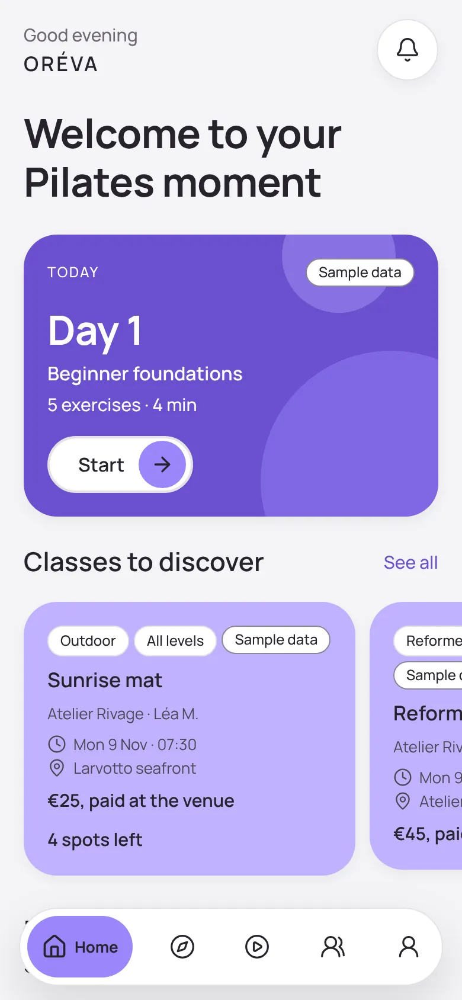 | 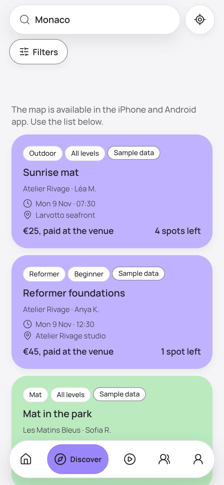 | 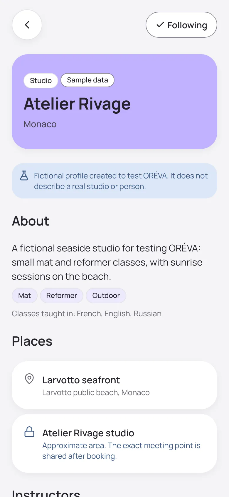 | 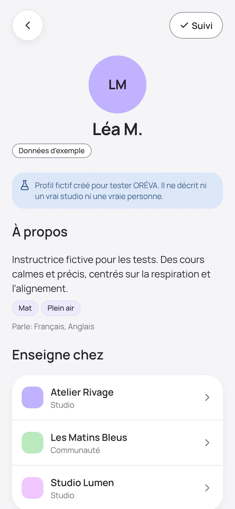 |  |

| Practice                          | Session                          | Player                          | Connect (FR)                     | Circle                          |
| --------------------------------- | -------------------------------- | ------------------------------- | -------------------------------- | ------------------------------- |
| 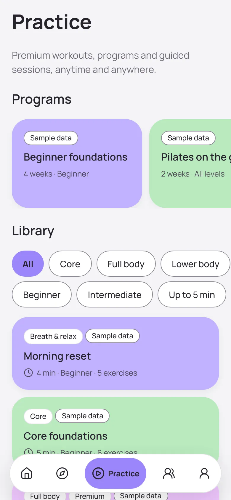 | 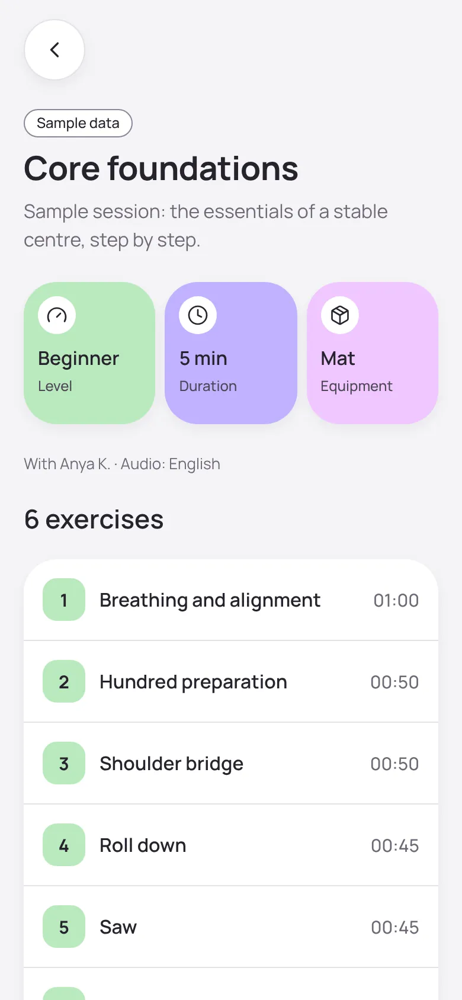 | 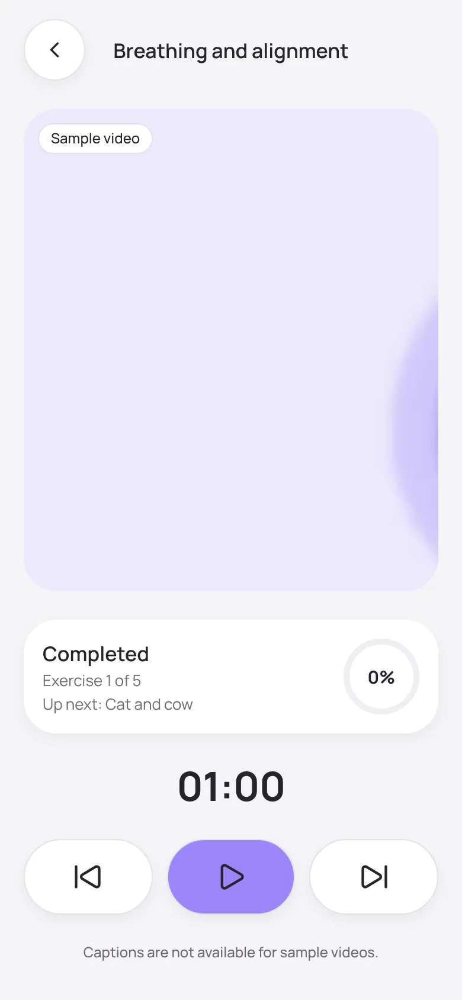 | 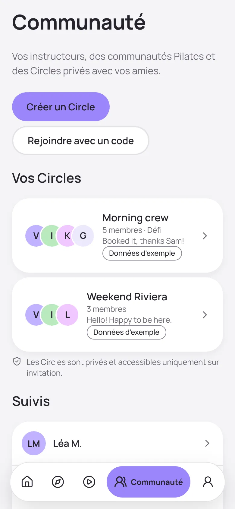 | 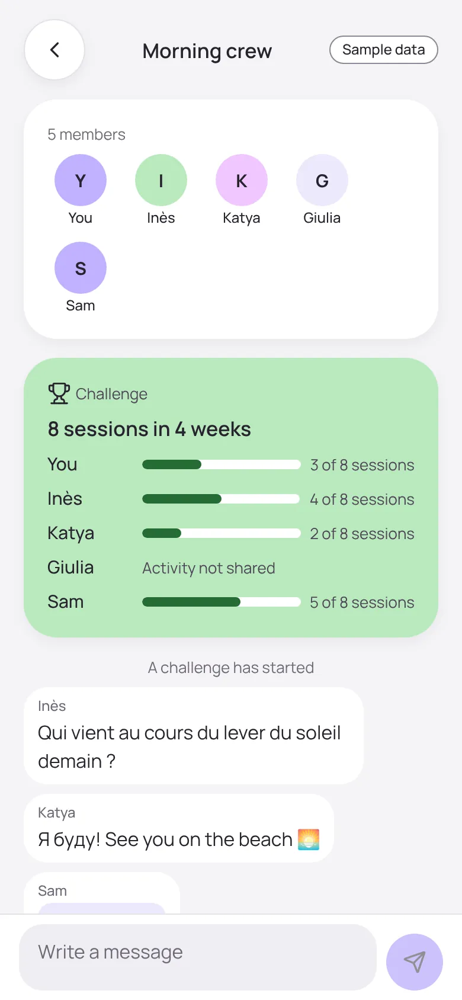 |

| Profile                          | Prototype settings                 | Home (RU)                     |
| -------------------------------- | ---------------------------------- | ----------------------------- |
| 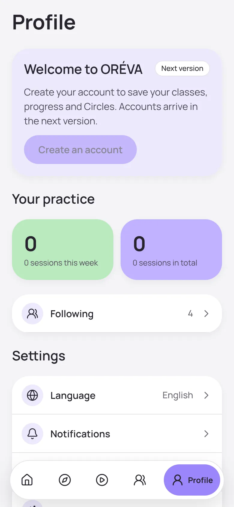 | 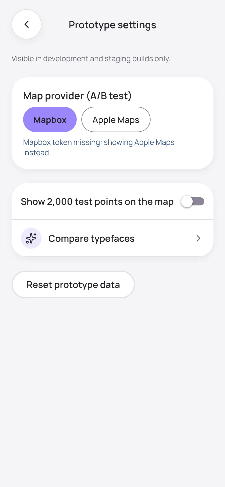 | 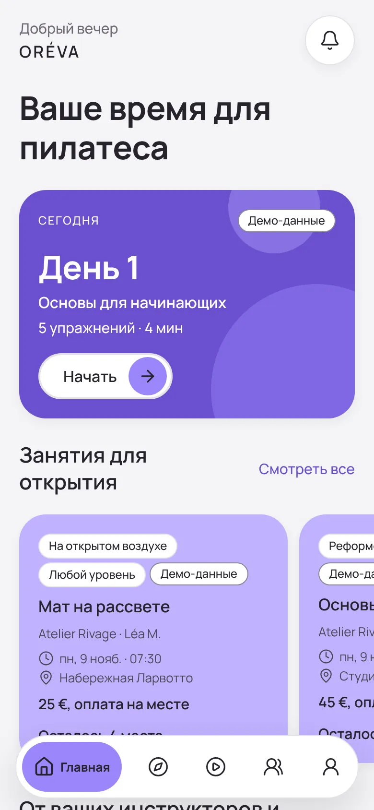 |

## Not verified here (needs the founders' iPhone)

- **The maps themselves.** No simulator here, and no Mapbox token yet. Both map implementations compile, bundle and follow the installed libraries' APIs, but **neither has been displayed on a device**. The A/B on iPhone is the deciding test (C-4).
- **Near me** with the real iOS prompt, and **video playback** on the device.
- **Android:** not tested in this phase. A Mapbox download token may be needed (see `iphone-testing.md`).
- Performance with 2,000 points on a real phone.

## Known limits (by design in Phase 2)

- No accounts: "Create an account" is disabled (Phase 3).
- No booking: the button is disabled with an explanation (Phase 7).
- Circles and messages are stored **on the phone only**, and joining by code is explained but disabled (Connect backend phase).
- Instructor and studio photos are replaced by initials until photos with documented consent exist.
- The French and Russian copy still need native review (O-07).

## Decisions for the founders

1. **C-4:** Mapbox or Apple Maps, after the iPhone A/B (protocol in `iphone-testing.md`).
2. **P-14:** Manrope or Onest. Design preview now switches the whole app.

## Next phase (on approval only)

Phase 3, Accounts: sign up, onboarding, consents, member or professional account, deletion and export. It needs the **Supabase staging project (EU)**.
